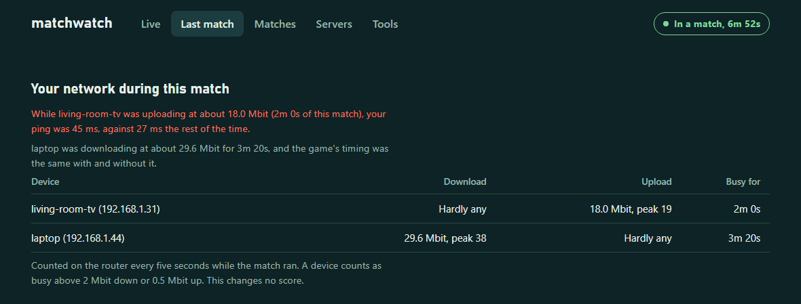
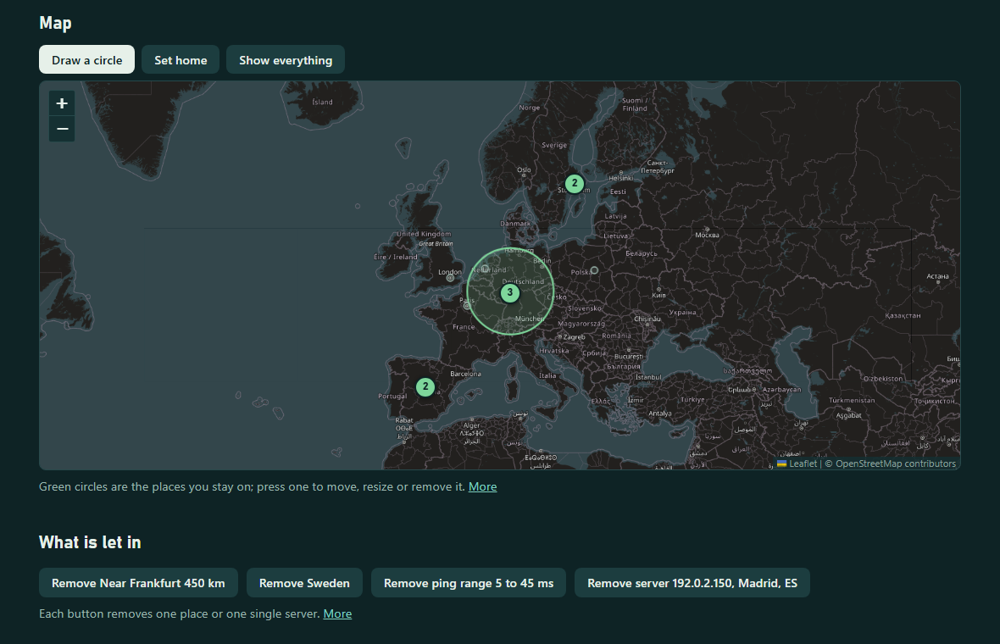
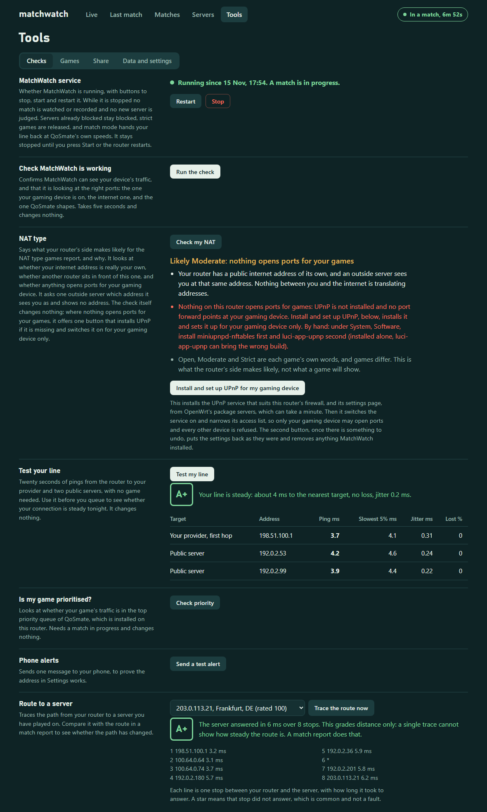

# MatchWatch

**Tells you why a match felt bad, from your OpenWrt router. v0.47.0 (pre-release)**


MatchWatch watches your game's traffic as it passes through the router and says where a bad match came from: the game server, the route to it, your own line, or your PC. Then it helps you do something about it. It lives in LuCI under **Services → MatchWatch**.

> **OpenWrt only.** It runs on a router with [OpenWrt](https://openwrt.org/) firmware. Nothing is installed on your PC or console, and it does not run on a router with its maker's stock firmware.

It works from packet timing only: game traffic is never decoded or injected. Out of the box it changes nothing about your connection. Blocking servers, the [ping buffer](#the-ping-buffer) (the one feature that holds game packets) and changes to other settings on the router only happen when you ask.

> **Status:** an early release, used daily on one router running OpenWrt 25.12, mostly with one game. Scores are a diagnostic estimate, not proof of a server's health. See [Limits](#limits).

## What you get

### It judges every match

Every match is spotted on its own and scored out of 100 in four parts: server, route, your line, your PC. Each part says in one line what cost it points. The report keeps a chart of the whole match, every stop on the route, and what else on your network was busy.


### It warns you while you can still leave

Half a minute into a match, usually while you are still in the lobby or the warm-up, MatchWatch says so if the server is already clearly rough: on the Live page and, if you use phone alerts, on your phone. If the server looks fine it says nothing.

### It shows who to blame, live and afterwards

A see-through bar for a stream or a second screen, with where you are playing, your ping, and a line each for the server, route, line and PC. And a picture of any match to share, with the scores and the timing and no address.


### It names what else on your network was busy

The router carries every device's traffic, so it can say which one was busy during a match, and whether the game was actually any worse while it was.



### It lets you choose your servers

Block a bad server or datacentre. Stay on places you draw on a map. Or let in only servers inside a ping range you set, with every measured datacentre marked on the slider.




### It checks the things that quietly ruin matches

A NAT check that says why your NAT is not Open and can put it right in one press. A line test and a route trace with grades. A check that QoSmate is prioritising your game, and whether its speed limits look right.



### It can even out a spiky line

A ping buffer holds the server's updates back by a set time so that late ones can catch up and your game receives an even beat, at the price of that much ping. It is off until you set it, and a rehearsal on your own matches says first whether your line would gain anything. On a steady line it would not.

### And the rest

- Remembers every match, with ratings per server, datacentre and hour of the day, and your favourite servers by game.
- Recognises around thirty popular games and lets you name any other. Voice chat is never recorded and never blocked.
- Phone alerts through ntfy: a match started, a poor server ahead, a bad match.
- Match mode: with QoSmate, one pair of speeds while you play and another the rest of the time.
- Share files you choose the contents of, item by item. Nothing is ever uploaded.
- No account and no cloud service. It is a shell script, two awk programs and a LuCI app, and it updates itself from GitHub when you press the button.

The pictures are made from invented data (`test/mockshots.py`). The game titles are real ones MatchWatch recognises; the addresses, hosts, devices and matches are invented.

## Contents

- [Install, update, remove](#install-update-remove)
- [The dashboard](#the-dashboard), including the overlay
- [How a match is judged](#how-a-match-is-judged), including the early warning
- [Alerts](#alerts)
- [Choosing your servers](#choosing-your-servers)
- [Games and voice chat](#games-and-voice-chat)
- [Sharing with other players](#sharing-with-other-players)
- [Tools](#tools), including the NAT check
- [The ping buffer](#the-ping-buffer), and whether it would help you
- [QoSmate](#qosmate), including match mode
- [Commands](#commands)
- [Privacy and security](#privacy-and-security)
- [Limits](#limits)
- [For developers](#for-developers)

## Install, update, remove

You need a router running OpenWrt 22.03 or newer with LuCI, SSH access to it as root, and a few megabytes of free storage. It must be the router your gaming device connects through. If your router runs its maker's firmware, check [openwrt.org/toh](https://openwrt.org/toh/start) for whether OpenWrt supports it.

### Install

SSH to the router and run one command:

```sh
uclient-fetch -O /tmp/matchwatch-install.sh https://raw.githubusercontent.com/ItsGix/matchwatch/main/dist/matchwatch-install.sh && sh /tmp/matchwatch-install.sh
```

Then, in LuCI:

1. Log out and back in, and open **Services → MatchWatch**. The menu entry only appears after a fresh login.
2. On the **Settings** tab, set **Device to watch** to your gaming PC or console. Until you do, MatchWatch watches every device.
3. Give that device a fixed address under Network → DHCP and DNS → Static Leases.

Then play a match. It shows up on the Live page within about ten seconds.

- To choose the device at install time, add its address to the end: `... && sh /tmp/matchwatch-install.sh 192.168.1.50`.
- If the router cannot download the file, fetch [`dist/matchwatch-install.sh`](dist/matchwatch-install.sh) on a computer and copy it over with `scp matchwatch-install.sh root@192.168.1.1:/tmp/`.

**What the installer does.** Read it before you run it: it runs as root. It installs `tcpdump` if missing, copies the program and the LuCI app into place, creates `/etc/config/matchwatch`, starts the service and runs a self-check. It works with both `apk` (OpenWrt 25.12) and `opkg` (older releases).

### Update

Open **Tools → Data and settings** and press **Check for an update**. If there is a newer version, **Update now** downloads the installer from this repository, checks it against a published checksum, and runs it. History and settings are kept.

- Nothing is checked or downloaded until you press the button, unless you switch on **Tell me when a new version is out** in Settings. Then the router looks once a day and tells you; it never installs by itself.
- It refuses during a match, because updating restarts MatchWatch.
- Over SSH: `matchwatch update` checks, `matchwatch update now` installs.
- A firmware upgrade keeps history and settings but removes the program. Run the installer again.

### Remove

```sh
sh /tmp/matchwatch-install.sh remove
```

keeps your history and settings. Use `purge` instead of `remove` to delete those too.

## The dashboard

**Services → MatchWatch** has two tabs, Dashboard and Settings. The Dashboard has five pages:

| Page | What is on it |
|---|---|
| **Live** | The match in progress: ping, update rate, jitter, late and missing updates, freezes, your PC's pauses, a two-minute chart and the "I felt that" button. A banner says where the game is sending you and how that server has rated |
| **Last match** | One match in full: verdict, the four scores with the reason for each, a chart of the whole match, each stop on the route, what QoSmate's queues did, and your marks |
| **Matches** | Every recorded match, your latest session in a sentence, and ratings by hour of the day |
| **Servers** | Four tabs. **Where I play**: the map, everything that is let in, and how each game is filtered. **Favourites**. **Servers**: servers, datacentres and blocks. **Regions and games** |
| **Tools** | Checks, connection tools, games, sharing, updating and data. See [Tools](#tools) |

Data is fetched every fifteen seconds and a page redraws only when something has changed. Longer explanations show their first sentence with a **More** link. Every page fits a phone.

**Settings.** The device to watch, phone alerts, blocking and staying, and the advanced capture options. Saving restarts MatchWatch, which ends the recording of a match in progress, so change settings between matches.

### The dashboard without login

Turn on "Dashboard without login" in Settings to also serve the dashboard at `http://<router address>/matchwatch/` to anyone on your network, for a phone or a second screen. It is view only: its one button is "I felt that". It is off by default.

### The overlay

A compact bar on a see-through background, updated every second, for a stream or a second screen. It is at `http://<router address>/matchwatch/#/overlay` and needs the dashboard without login switched on. Under **Tools, Data and settings, Live overlay**, tick what you want and copy the address it builds.

- **Every part is optional**: the place (city and country, never the address), the game, your ping, the lights, the lines, the marks, this server's rating and the match time. There are three sizes, and it can hide itself between matches.
- **The four areas** are Server, Route, Line and PC. Each has a light and a line of its last minute, which turn amber or red while a problem lasts, and marks underneath that stay for the minute.
- **Three extras, off until ticked:** *Matches played* this sitting (a sitting ends after two hours without a match), *Updates missing* under the ping (amber from 1%, red from 3%), and *the verdict* for half a minute when a match ends.
- **If the Line light stays grey**, your ISP's first hop answers no pings. Untick Line; line faults show under Route instead.
- **In OBS**, add a Browser source with the address: 480 by 60 for the small size, 560 by 70 for medium, 700 by 90 for large, a tenth taller with Matches played.
- **By hand:** `#/overlay?show=place,game,ping,lights,lines,marks,rate,time,miss,played,verdict&areas=server,route,pc&size=s` (sizes `s`, `m`, `l`; `&idle=0` hides the bar between matches). Leave out a word to leave out that part.

A fault is placed with the nearest thing that explains it: a jump in the ping to your ISP's first hop is the line, extra ping beyond that is the route, late updates with a steady ping are the server, and a pause in what your PC sends is the PC. It is a moment's best guess, and its amber and red lines are first guesses too. The match report has the whole match to judge from and is the final word.

## How a match is judged

MatchWatch times the game's own packets, adds a few pings of its own, and scores four parts out of 100.

### What it measures

- **Server.** A server sends updates on a fixed beat. MatchWatch measures how evenly they arrive: the update rate, timing jitter, late updates, updates that arrived in clumps (held up on the way), missing updates, and stutters and freezes (gaps over 50 and 100 ms).
- **Route.** One ping a second to the server. If it ignores ping, it is probed the way traceroute does every two seconds; servers ration those replies, so unanswered ones are not loss. Failing that, the last hop that answers is used and judged more leniently.
- **Your line.** One ping a second to the first hop inside your ISP.
- **Your PC.** Whether it keeps sending without pauses, measured as its packets reach the router. Only pauses over 100 ms are scored, because games tie their send rate to frame rate. "Count your PC towards scores" in Settings leaves it out of the overall score.

### Which stop on the way

Through every match MatchWatch pings each stop on the route that answers, every six seconds, and the report lists them with ping, jitter and loss. If trouble starts at one stop and is still there at every stop after it, the report says so, and says when that stop is at or near your own provider. A single rough stop with steady stops after it means nothing and is not blamed. This is information to show your provider; it changes no score.

### The four scores, and why

Under each score the report prints one line saying what cost the most points, or "Nothing to fault": for example "Ping 73 ms: a long way to the server" or "2.40% of updates went missing; 3 freezes over 100 ms".

### What takes points off

| Score | Starts at 100 and loses points for | Most it can lose |
|---|---|---|
| Server | Timing jitter above 5% of one update | 30 |
| | Updates late or in clumps (4 points per 1%) | 25 |
| | Missing updates (12 points per 1%) | 35 |
| | Stutters over 50 ms, counted per ten minutes | 30 |
| | Freezes over 100 ms, counted per ten minutes | 20 |
| | Rough stretches beyond 5% of the match | 20 |
| Route | Ping jitter above 1 ms (6 points per ms) | 35 |
| | Lost pings (12 points per 1%; not counted for the traceroute-style probe) | 45 |
| | Ping above 40 ms (1 point per 2 ms) | 20 |
| Your line | Jitter above 3 ms to the first ISP hop (3 points per ms) | 35 |
| | Loss to the first ISP hop (6 points per 1%) | 45 |
| Your PC | Pauses over 100 ms in what it sends, counted per ten minutes | 45 |
| | Send jitter above 60% of one update | 10 |
| | Jitter or loss between router and PC | 80 |

So a steady route to a far server scores in the low 80s for distance alone, and a few short pauses in a long match cost the PC a few points. Neither is a fault.

### The overall score and the verdict

- The overall score is 60% the weakest counted part and 40% a weighted average (server 45%, route 25%, line 15%, PC 15%). Grades: 85 and over Excellent, 70 Good, 50 Fair, below that Poor.
- **The game's own traffic is the ground truth.** When its packets arrived cleanly (server 80 or more), a lower route score is shown but not counted.
- Scoring starts when steady game traffic begins, so the wait before a match is not counted.
- A match counts towards a server's rating only when it lasted at least a minute and your own line was stable.

### "I felt that"

Press the button on the Live page (or the M key) when something feels off: a shot that should have hit, a rubber-band, a death behind cover. MatchWatch looks at the six seconds before the press and says whether the server stalled, your ping jumped, your PC stopped sending, or nothing showed on the network. Marks appear on the chart, in the report and in the history.

### The early warning

The early warning looks at the first half minute of a game's steady traffic and speaks once, only if the server is already clearly rough: 3% or more of its updates missing, 8% or more late, two freezes, or rough for half of that time. The Live page shows the reason in red, the overlay gains a light, and your phone gets one line if you use alerts.

- The lines are set high on purpose, because a false alarm costs you a good match. They are first guesses.
- It applies to recognised games only, and it only tells you: whether leaving a lobby costs anything is the game's rule.
- To keep it off your phone: `uci set matchwatch.main.early_warn=0`, `uci commit matchwatch`.

### What on your network was busy

During a match MatchWatch counts each device's traffic every five seconds, and the report shows the result under **Your network during this match**.

- **A row per busy device**, by the name it gave the router: above 2 Mbit down or 0.5 Mbit up. Your gaming device has a row too.
- **A comparison, not a guess.** The game's timing and your ping while the device was busy are set against the rest of the match, and the report says whether they were clearly worse or the same. With QoSmate holding the line, a busy device often changes nothing.
- IPv6 traffic is one row for all devices. With flow offloading on in the firewall the figures are incomplete, and the report says so.

Nothing is counted between matches, it changes no score, and the figures stay on the router. To switch it off: `uci set matchwatch.main.net_watch=0`, `uci commit matchwatch`.

### A picture to share

Every match report has **Save a picture of this match**: the overall score, the verdict, the four parts and the timing, with the game, the place and the time. It carries no address and is saved to your own device.

## Alerts

MatchWatch can send short messages to your phone through ntfy. Install the ntfy app, subscribe to a hard-to-guess topic, and put `https://ntfy.sh/<your topic>` under Alerts in Settings. **Send a test alert** on the Tools page proves it works. Alerts are one short line each, with no addresses; the detail is in the dashboard.

| Alert | Reads like | When |
|---|---|---|
| Match started | Match started: United Kingdom, 5 ms. | Each match, if switched on. For stepping away during a long queue |
| Lobby | Poor server ahead: United Kingdom, 5 ms. Rated 40/100 before. | A far or poor server, at most one a minute |
| Match ended | Match ended: 41/100 Poor. | After a bad match, or every match if switched on |
| New game | New game on server port 4444. Name it in MatchWatch, or mark it as not a game. | The first match on an unknown port |

**The lobby check** runs when the game first contacts a server MatchWatch recognises as a game server. It looks up where the server is, measures the ping and checks its history. The Live page shows the result with a button to block the server before the match starts, and your phone is told when the server is far or has rated badly. It needs at least one recorded match first.

**Ping sweeps are not announced.** Some games measure their ping to every datacentre at once; Call of Duty does it every twenty minutes. Four or more different servers within three seconds count as a sweep: one line in the log, and nothing on the Live page or your phone.

## Choosing your servers

The game decides which server you get. MatchWatch cannot request one, but it can refuse servers so the game has to place you elsewhere: block servers, stay in a pool of places, or set a ping range.

### Blocking

A block refuses one server or one datacentre. Blocks live in their own nftables table, so your firewall rules are untouched.

- Blocking takes effect on your next match. Never block the server you are playing on unless you want to be disconnected.
- Server addresses are reused, so blocks expire ("Blocks last" in Settings). Blocking many servers lengthens matchmaking.
- Automatic blocking is off by default. When on, a server is blocked after two counted matches averaging under 45.
- Blocking a datacentre blocks every /24 address block you have been placed on there. It cannot know the datacentre's other blocks.

### Favourites

Press the star beside any server. The Favourites tab lists them by game, best rated first.

- A favourite is never blocked automatically, and the lobby check tells you when the game is sending you to one.
- A star does not put a server in the pool; [add it to the pool](#single-servers-in-the-pool) for that.
- Favourites can be shared, and clearing your match history keeps them.

### Staying in a pool of places

Staying keeps you to servers in places you choose, whoever hosts them. Type places into the box on the Servers page, press a "Stay here" button, or use `matchwatch stay <places>`, separated by commas:

- **A city**: `milan`, `helsinki`. Servers within 150 km are allowed. Cities not in the regions table are looked up with Open-Meteo, which is sent only the name.
- **A country** (`italy` or `it`), **an area** (`western-europe`; `matchwatch places` lists them), or **a datacentre number** from `matchwatch datacentres`.

Several places make one pool. A bigger pool means shorter queues.

- Every address block you have played on outside the pool is blocked at once, and any other server is looked up and turned away as the game reaches for it, before anything is measured. You are refused in the lobby, not thrown out of a match later.
- A match in progress is never cut off.
- It applies only to servers MatchWatch recognises as game servers. Name a "Game on port N" first.
- The game decides which regions to offer you. Far places may take several failed connections, or never come up. Server locations come from a public lookup and are occasionally wrong.
- A place is dropped from the pool, and you are told, if its last three counted matches average under the warning rating.

### The map

The Servers page has a map of everything MatchWatch knows.

- **Your places** are green circles. Press **Draw a circle**, press the middle, drag outwards and let go (two taps on a touch screen). Press a circle to move, resize or remove it.
- **Servers you have played on** are markers coloured by rating; a faded one is outside your places. Press one for its servers and the favourite, Add to pool and Block buttons.
- **Datacentre regions** are small hollow dots; hover for the ping and its grade.
- **Set home** marks roughly where you are. It is remembered only by your browser.

Map pictures are tiles from OpenStreetMap, fetched by your browser. The map library, Leaflet, is installed on the router with MatchWatch.

### The ping range

A ping range lets in only game servers whose ping is between a lowest and a highest you set. It is on Servers, Where I play, under **Ping range**.

- Drag the two handles or type the figures. Each mark on the line is a measured datacentre, lit when the range lets it in. Put an end of the range in a gap between groups of marks, not on one.
- **A highest alone** keeps you on near servers, **a lowest alone** keeps you off them, **both** make a band. With places as well, a server has to pass both.
- **The ping has to be known before the game connects**, or the game would join and then be thrown out. MatchWatch uses the lowest ping of your own matches on that server's address block, and otherwise the nearest measured datacentre within 250 km. A server whose ping is not known is let in.
- **A game's relays are never turned away.** Call of Duty keeps a few packets going to a relay beside its game server; turning that away leaves the game on "connecting to relay".
- Single servers you added to the pool are always let in.

It only refuses servers by a ping MatchWatch has measured; it does not change your connection or what the game sees of it. From the command line: `matchwatch pingrange`, `pingrange 60 110`, `pingrange 0 40` (no lowest), `pingrange off`.

### Single servers in the pool

**Add to pool** lets one server through your places and your ping range, whatever region it is in. The button appears beside servers and on match reports while either is set.

- Only the exact address is allowed; its neighbours are still refused.
- An allowed server is never blocked automatically. Blocking it yourself takes it back out.
- The game still decides. Allowing a server means it will not be refused, not that you will be sent to it.

From the command line: `matchwatch allow`, `allow add <ip>`, `allow remove <ip>`.

### When a server is turned away

How soon staying acts depends on how sure MatchWatch is that a server belongs to a game. The Servers page shows which applies to each game, under "How each game is filtered".

| The game is | A server outside your places is turned away | You need to |
|---|---|---|
| Known by port and by who hosts it (Call of Duty, Valorant, League of Legends, Overwatch 2, War Thunder, iRacing) | From the first one the game tries, once looked up | Nothing |
| Hosted by a company with a published address list (Call of Duty on Vultr) | Before the game even tries it | Nothing |
| Known by port alone (Fortnite, Apex Legends, Rocket League and most others) | Only on a port or address block where you have already played | Play one match, or make the game strict |
| Any named game you made strict | Before it can connect, every time | Press Make strict |
| Not named ("Game on port N") | Never | Name it first |

Other traffic uses the same ports, so a port alone is not proof of a game. A match played on a server outside your places opens its report with the reason it was not turned away.

### Strict games

Normally a new server gets its first packets through while it is being looked up. Make a game **strict** (Servers page, Strict games) and every new server on its ports is held until MatchWatch has placed it, usually well under a second.

- It applies only to your gaming device, that game's server ports, and while you are staying on places or have a ping range.
- **Voice chat is never held**, and a game that lives mostly on voice chat ports, such as Roblox, cannot be made strict.
- **It fails open.** If MatchWatch is stopped or cannot look a server up, nothing is held.

From the command line: `matchwatch strict`, `strict on "Call of Duty"`, `strict off`.

### Whole regions, ahead of time

When you stay on places, MatchWatch also refuses every address range it knows to be outside them, before the game tries any. It knows from lists hosting companies publish themselves. One is built in: Vultr, which hosts every Call of Duty server seen so far. The router downloads the list when you start staying and weekly after; nothing about you is sent.

- The Servers page names the hosts and games this covers, and warns when a place you chose has no servers, offering the nearest that do.
- Only your gaming device's game traffic is refused. Web sites on the same company and every other device are untouched.
- A range whose city cannot be placed is left alone.
- To add a host that publishes such a list: `name|address` in `/etc/matchwatch/geofeeds.local`, then `matchwatch ranges refresh`.
- "Turn whole regions away ahead of time" in Settings switches it off.

### Regions and where each game plays

- **Every region.** The ping from your router to about thirty datacentre regions, graded A+ to F, with your matches there. It pings Vultr's public test servers, every six hours and on "Measure now".
- **Where each game plays.** One row per game and place. Your own router only learns the places a game offers you; the rest comes from other players' [share files](#sharing-with-other-players), marked "Shared with you". Nothing is blocked or allowed because of shared entries.

### Removing things

Matches, servers, datacentres, shared ratings, games you added and blocks each have a **Remove** button that asks twice. Ratings and tables are rebuilt without what you removed. A favourite shows **Kept** where Remove would be: take the star off first.

## Games and voice chat

### How a game is recognised

MatchWatch never looks inside packets. It recognises a game from the **port** on its server and, where a port is shared, **who hosts the server**. The list ships as a plain text file and changes only when you update, name a game or import names.

| | |
|---|---|
| By port and host | Call of Duty, Valorant, League of Legends, Overwatch 2, Roblox, War Thunder, iRacing |
| By port | Fortnite, Apex Legends, Rocket League, Counter-Strike 2, Dota 2, Deadlock, Team Fortress 2, Destiny 2, Minecraft (Bedrock), Rust, ARK, DayZ, Palworld, Among Us, Genshin Impact, Street Fighter 6 |
| By port, from unofficial figures | Battlefield, Rainbow Six Siege, Escape from Tarkov, World of Tanks, EA Sports FC, Smite, Paladins |

The list cannot be complete. Many publishers do not publish their ports, games on Steam's network share one label, games hosted player-to-player have no server port, and games that do not use UDP for play (Final Fantasy XIV, World of Warcraft, Minecraft Java) are not seen as matches.

### Which game a match was

A port cannot always name the game. Games on Steam's network all look alike, so they show as "A Steam game" until you say which, and now and then a port names the wrong game. The Live page and every match report have a small link (**which game?**, **Wrong game?** or **change**) that opens a box: type the name and choose how long it applies.

- **This match only**, the default for a wrongly named game.
- **1 day** (the default for a shared network), **1 month** or **until I change it**, which rename every match filed under that label for that long.

This changes the name only. Filtering still goes by the server's port; if a port is always another game for you, use **Add a game** on the Tools page. From the command line: `matchwatch matchgame <match start> <name>`.

### Games it does not recognise

A game not on the list is still rated, as "Game on port N", if it looks like one: at least two minutes of play and a steady stream of updates.

- Shorter or patchier streams are not recorded. They are listed under **Skipped, not recorded** on the Tools page, where you can name one if it was a game. A stream that keeps starting and stopping is left alone for six hours.
- The first time an unknown game is recorded, a banner offers a box to name it and a **Not a game** button.
- **Add a game** on the Tools page takes a port or range, a name and, for a range over 2000 ports, a word from the name of the company hosting the servers.

Until a game has a name, staying on places, the lobby check and automatic blocking leave it alone.

### Voice chat is left alone

Voice chat is not a match. MatchWatch does not record it, alert about it or block it. Recognised as voice: Discord, TeamSpeak, Mumble, Valorant's voice servers, and the ports consoles and games use for party chat. Discord and Roblox share the same high ports and are told apart by host, which needs "Look up where servers are" switched on.

## Sharing with other players

A share file lets MatchWatch users pass what they have learned to each other. It is a small text file you can read in any editor. Make one, or take one in, on the **Tools → Share** tab.

### What a share file can hold

| Section | What importing it does |
|---|---|
| Game names | Adds them to your own names. A name you gave yourself always wins |
| Places you stay on | Adds them to your pool and turns staying on |
| Game servers by place | Adds them to **Where each game plays**, marked "Shared with you" |
| Favourite servers | Adds them to your favourites. You can also choose **Stay near those servers** |
| Network ratings | Shows them in a table, and the lobby check mentions one the first time you land on that network |
| Ping hosts | Adds test hosts to the regions table and measures them |
| Thresholds | Sets your rating and capture thresholds to match, and restarts MatchWatch |

### Choosing exactly what to share

"Choose what to share" lists everything you could share, each item with its own tick. Favourite servers can be narrowed by game, rating, place and number of matches. The box underneath is the file itself and changes as you tick. When you take a file in, you choose by section.

### What keeps it safe

- **Nothing is uploaded**, and nothing about your home goes in: no device name, no LAN or ISP address, no match times. The whole file is shown before you save it.
- **Every imported line is checked.** Lines that are malformed or could do harm are left out and listed.
- **Other people's ratings never block anything.**
- **Checking a file changes nothing**, and **Undo the last import** puts things back.
- A share file cannot turn on automatic blocking, change your alerts address or choose the device to watch.

### From the command line

```
matchwatch share export > mine.txt            # everything
matchwatch share export games favourites > mine.txt
matchwatch share check theirs.txt             # what is in it; changes nothing
matchwatch share import theirs.txt            # or: ... import theirs.txt games
matchwatch share import theirs.txt favourites favplaces   # their favourites, and stay near them
matchwatch share undo
matchwatch share forget                       # remove ratings other people shared with you
```

The [`packs/`](packs/) folder is for game packs anyone can use; [`packs/README.md`](packs/README.md) has the format.

## Tools

The Tools page has five tabs: Checks, Connection, Games, Share, and Data and settings. Each tool says what it does beside its button.

### Checks

- **MatchWatch service.** Whether it is running and since when, with **Stop**, **Start** and **Restart**. While stopped, no match is recorded and no new server is judged; existing blocks stay, strict games are released, and match mode hands your line back at QoSmate's own speeds. If it stops by itself, the row says why.
- **Check MatchWatch is working.** Confirms it can see your device's traffic and is looking at [the right ports](#the-three-ports). Five seconds, changes nothing.
- **Report a problem.** Gathers the self-check, versions, settings, files and the last log lines into one text to pass on, with your internet address, alert address and device names left out.
- **NAT type.** See [The NAT check](#the-nat-check).
- **Test your line.** Twenty seconds of pings to your provider's first hop and two public servers, with no game needed.
- **Is my game prioritised?** Needs [QoSmate](#qosmate) and a match in progress.
- **Phone alerts** sends one test message, and **Route to a server** traces the path to any server in your history.

Tests get a letter from A+ to F:

| Test | Graded on | A+ | A | B | C | D | E |
|---|---|---|---|---|---|---|---|
| Line test | Loss, jitter and slow replies shared by every target, as a score | 97+ | 90 | 80 | 70 | 55 | 40 |
| Route trace, region pings | The ping in ms | to 15 | 30 | 50 | 80 | 120 | 180 |

### The NAT check

It says what your router's side makes likely for the NAT type games report (Open, Moderate or Strict), and why: whether your internet address is your own or shared by your ISP, whether another router sits in front of this one, and whether anything opens ports for your gaming device. It asks one outside server which address it sees you as, only when you press the button, and shows no address.

**UPnP.** If nothing opens ports for your games, the check offers **Install and set up UPnP for my gaming device**.

- It installs the build that suits your firewall (`miniupnpd-nftables` on current OpenWrt) and `luci-app-upnp`, replacing the wrong build if that is there.
- It switches the service on and narrows its access list so only your gaming device may open ports. The stock list lets every device.
- **Put UPnP back as it was** restores the old settings and removes what MatchWatch installed.

**A port forward, for games that never ask.** Call of Duty on PC stayed on Moderate with UPnP running. Once one of your games has sent from the same port in three recent matches, the check offers **Forward port N to my gaming device**: one UDP port, to that device only, as an ordinary port forward. **Remove the forward MatchWatch added** takes out only that.

From the command line: `matchwatch nat`, `nat fix`, `nat unfix`, `nat forward [port]`, `nat unforward`.

### The three ports

MatchWatch relies on three network ports on the router, and a wrong one never shows as an error: a feature just quietly does nothing. **Check MatchWatch is working** tests each, and a warning appears at the top of the Tools page if one is wrong.

| Port | Used for | If it is wrong, correct it in |
|---|---|---|
| The one your gaming device is on | Seeing matches at all | MatchWatch: Settings, Advanced, LAN interface |
| The internet one | Other traffic on your line, the priority check | MatchWatch: Settings, Advanced, WAN interface |
| The one QoSmate shapes | Match mode, "QoSmate in this match", the priority check | QoSmate's own settings. MatchWatch reads it from there |

### Connection, Games, Share, Data and settings

- **Connection.** **Ping buffer** and **Would a ping buffer help me?**: see [The ping buffer](#the-ping-buffer). **Is my line losing packets?** reads your last forty matches for signs of lost packets (pings lost to your provider, your device and the servers that answer them, and drops in QoSmate's game queue); the router cannot see what the server received, so these are signs, not a count. **Match mode**, **Are my QoSmate speeds right?** and **Prioritise my game traffic**: see [QoSmate](#qosmate).
- **Games.** **Name a game** and **Add a game** (see [Games it does not recognise](#games-it-does-not-recognise)), **Your games** with a Remove button each, and **Skipped, not recorded**.
- **Share.** See [Sharing with other players](#sharing-with-other-players).
- **Data and settings.** **Update MatchWatch** (see [Update](#update)), **Match history** as a spreadsheet file, **Clear all history** (blocks, favourites, places and settings are kept), **Recent activity**, **Live overlay** (see [The overlay](#the-overlay)) and the settings in use.

## The ping buffer

Some gaming routers sell a *ping buffer*: your game's packets are held back by a set time so that a spiky line feels even. MatchWatch has one, off until you set it. Unlike the others it first rehearses the buffer on your real matches, so you can see what it would do on your line before paying for it in ping.

**Who it is for.** A line that stalls for a few tens of milliseconds and then delivers the held updates together: cable at busy times, 4G and 5G, a long Wi-Fi or powerline link to the modem. On a steady line it adds delay and smooths nothing, and the rehearsal will say so.

### How it works

A game draws other players a little in the past, by at least one of the server's update intervals, so an update that arrives slightly late is never seen. One that arrives later than that is the freeze, the teleport, the "packet burst".

The buffer follows the server's beat. An update that arrives on time waits the whole buffer, one that arrives 15 ms late waits 15 ms less, and one later than the buffer goes straight through, so your game receives an even beat. A plain delay, which is all some routers add, holds every packet the same time: the spikes stay and only the ping rises.

The price is that everything you see is older by the buffer, in every fight. It also cannot help with:

- **updates that never arrive**: it cannot bring back what was lost;
- **your own shots**: nothing your device sends is held, because those packets have no beat to restore;
- **the other player's connection**, which is most of dying behind cover;
- **stalls longer than the buffer**: hiding an 80 ms stall takes about 65 ms of buffer;
- **close fights and peeking**, where whoever sees first wins and a buffer makes you see later.

### Rehearse it first

For every update MatchWatch notes how late it arrived, and from that how many came later than a game hides by itself and how many of those a buffer of each size would have hidden. Each match report answers for that match under **Would a ping buffer have helped?**; **Tools, Connection, Would a ping buffer help me?** (or `matchwatch buffer`) answers for your last forty matches. It holds nothing back.

The count assumes the game hides one update interval itself. Games do not publish theirs, so read the figures as a guide.

### Switching it on

Under **Tools, Connection, Ping buffer**, type a figure from 5 to 100 ms and press **Hold this much**, or press **Size it for me** for the smallest buffer that would have hidden nine in ten late updates in your recent matches (never over 40 ms, and nothing on a steady line). From the command line: `matchwatch buffer hold 25`, `buffer auto`, `buffer off`, `buffer status`.

It starts a minute into a match, once any pre-game lobby is over, and stops when the match ends. Set during a match, it starts within a minute.

### What is held, and what the game sees

- **Held:** from a minute into a match until it ends, everything arriving from the port the match is on for your gaming device, whichever address sends it. A game can have more than one route to a match (Call of Duty does), so all are held alike: the match's own updates get the buffer, anything else on that port a plain hold of the same size.
- **Not held:** other ports, everything between matches, everything your device sends, and every other device.
- **What the game sees:** every route to that match looks slower by the buffer, and your game shows its ping higher by that much. A ping the game sends to a server on the same port while the match is on reads slower too, so matchmaking can see some servers as further away than they are during a match. If you would rather a game never saw anything but your true line, leave the buffer off.
- **What MatchWatch shows:** its own ping is measured past the buffer and stays your real one. Everything else on the Live page, and the match's scores, are the stream as your device received it. A line on the Live page and a section in the report say what the buffer did.

### When it stands back

- **A server that keeps no beat.** Some servers send at changing intervals, and holding those would make the stream less even. When the buffer keeps losing the beat (sixteen times within 256 packets) it stops holding for the rest of that match, and the report says so.
- **Matches that keep ending under it.** If twice within five minutes a match ends within a minute of the buffer starting, it rests for fifteen minutes and says so. Setting it again ends the rest.
- **Always.** It lets go when the match ends, when MatchWatch stops, and within a minute if no match is on or it saw none of the match's packets (software flow offloading can send them past it).

### What it needs

Four OpenWrt packages: `kmod-sched-bpf`, `kmod-sched`, `kmod-ifb` and `bpftool-minimal`. A router running QoSmate has two already. When any is missing the Ping buffer row says so and offers **Install what it needs** (`matchwatch buffer install`); **Remove what was installed** (`matchwatch buffer uninstall`) switches the buffer off and takes away exactly those. Nothing is installed until you press, and the rehearsal works without any of it. Routers with a big-endian processor are not supported yet.

## QoSmate

[QoSmate](https://github.com/hudra0/qosmate), by hudra0, is a separate package that prioritises traffic on OpenWrt. It is what gives a game low latency on a busy line; MatchWatch measures, and QoSmate does the work. MatchWatch runs without it; with it, four things are added.

### Match mode

QoSmate keeps your game ahead by holding your line a little under its full speed, so that any queue forms in your router. The cost is that the limit is there all day. With match mode on, MatchWatch switches the limit between two sets of speeds, and you choose both. It is off by default: turn it on under **Tools, Connection**, or in Settings.

| | What it is | If you leave it alone |
|---|---|---|
| **While you play** | The speeds QoSmate holds your line to during a match | QoSmate's own rates |
| **Between matches** | The speeds for the rest of the time | No limit |
| **Switch after a match** | How long after a match before the between-matches speeds take over | 5 minutes |

Each speed has a box for megabits and a slider in percent of QoSmate's own rate. Nothing changes until you press **Save these speeds**.

- The playing speeds come on when the game first reaches for a game server.
- MatchWatch never writes QoSmate's settings and does not restart it. It gives the queue a rate, or "unlimited", and nothing else.
- It fails towards QoSmate's own limits: stopping MatchWatch, switching match mode off, or restarting QoSmate all put QoSmate's rates back. MatchWatch checks once a minute and sets your speeds again if something else moved them.
- It needs QoSmate switched on, in one of its cake modes, with QoSmate's autorate off. If it cannot work, the Tools page says why.
- A playing speed above what your line really delivers gives QoSmate nothing to work with, and one far below it only slows everyone else.

Over SSH: `matchwatch matchmode on`, `matchmode off`, and `matchwatch matchmode speeds <playing down> <playing up> <between down> <between up> [seconds]`, in kbit, where 0 means the default.

### Did QoSmate do its job in this match?

In QoSmate's cake modes, each match report has a "QoSmate in this match" section, read from QoSmate's queue counters: whether the game's own queue dropped or delayed anything, and whether other traffic was held back while the game went ahead. It only reads.

### Is my game prioritised?

Once per match, and on demand, MatchWatch checks that the game's traffic is in the top priority queue.

### Prioritise my game traffic

If it is not, this button (or `matchwatch qos fix`) adds two QoSmate rules, `matchwatch_out` and `matchwatch_in`, which mark all UDP to and from your gaming device, except web ports 80 and 443, as top priority. QoSmate is then restarted, so do it between matches. "Remove the rules" takes them out again. Rules named `Game_Outbound` and `Game_Inbound` from an older version are adopted and renamed.

## Commands

Everything is also available over SSH:

| Command | What it does |
|---|---|
| `matchwatch live` | The match in progress, updated every second |
| `matchwatch last` | Full report for the last match, with the route trace |
| `matchwatch history` | Recent matches. Add a number for more, or a server IP for one server |
| `matchwatch servers` / `datacentres` | Everything seen, worst first |
| `matchwatch hours` / `recap` / `games` | Ratings by hour, the latest session, games seen |
| `matchwatch block <ip> [days]` | Block a server (14 days by default, `0` = until unblocked) |
| `matchwatch unblock <ip>` or `all` | Remove a block |
| `matchwatch block-dc <n>` / `unblock-dc <n>` | Block or unblock the address blocks seen in datacentre n |
| `matchwatch blocklist` | What is blocked and for how long |
| `matchwatch fav` / `fav add <ip>` / `fav remove <ip>` | Your favourite servers |
| `matchwatch stay <places>` / `stay off` | Keep to a pool of places, separated by commas |
| `matchwatch stay add <places>` / `stay remove <n>` | Change the pool |
| `matchwatch stay circle <lat> <lon> <km>` | Add a circle to the pool, as the map does |
| `matchwatch pingrange` / `pingrange <lowest> <highest>` / `pingrange off` | Only let in game servers whose ping is in that range, in ms (0 for no limit on that side) |
| `matchwatch allow` / `allow add <ip>` / `allow remove <ip>` | Single servers let through your places and ping range |
| `matchwatch strict` / `strict on <game>` / `strict off <game>` | Hold every new server of a game until it has been placed |
| `matchwatch places` | The areas you can stay on |
| `matchwatch ranges [refresh]` | The hosting companies' address lists used to turn whole regions away |
| `matchwatch regions [measure]` | Ping every region, nearest first |
| `matchwatch game name <port or lo-hi> <name> [hosts] [voice]` / `game remove` | Name a game by port, or take a name away |
| `matchwatch matchgame <start> [name]` | Say which game a match was |
| `matchwatch mark` | Flag this moment, same as the "I felt that" button |
| `matchwatch qos` | During a match: is the game in QoSmate's top priority queue? |
| `matchwatch qos fix` / `qos unfix` | Add or remove QoSmate rules that prioritise your gaming device |
| `matchwatch qos advice` | What your last forty matches say about QoSmate's speed limits |
| `matchwatch matchmode` / `matchmode on` / `matchmode off` | With QoSmate: one pair of speeds while you play, another between matches |
| `matchwatch matchmode speeds <down> <up> <down> <up> [seconds]` | Choose those speeds, in kbit, and how soon after a match they switch |
| `matchwatch buffer` | The ping buffer rehearsal over your last forty matches. Holds nothing back |
| `matchwatch buffer hold <ms>` / `buffer auto` / `buffer off` / `buffer status` | The ping buffer: hold by 5 to 100 ms, size it from your matches, switch it off, or see what it is doing |
| `matchwatch buffer install` / `buffer uninstall` | Install the OpenWrt packages the buffer needs, or remove the ones MatchWatch installed |
| `matchwatch loss` | Signs of lost packets in your last forty matches |
| `matchwatch device [<ip>\|all]` | List the devices on your network and choose which to watch |
| `matchwatch doctor` | Checks that capture works. Changes nothing |
| `matchwatch report` | One text to pass on when something is wrong, with your addresses and device names left out |
| `matchwatch nat` | What your router's side makes likely for your NAT type, and why |
| `matchwatch nat fix` / `nat unfix` | Install and set up UPnP for your gaming device only, or put things back |
| `matchwatch nat forward [port]` / `nat unforward` | Forward the game's own UDP port to your gaming device, or remove that forward |
| `matchwatch service` / `service stop` / `service start` / `service restart` | Whether MatchWatch is running, or stop, start or restart it |
| `matchwatch update` / `update now` | Whether GitHub has a newer version; with `now`, download and install it |
| `matchwatch forget match <start>` / `server <ip>` / `dc <n>` | Remove one match, server or datacentre. Favourites are kept |
| `matchwatch clear-history` | Forget every recorded match. Blocks and settings are kept |
| `matchwatch share export` / `check` / `import` / `undo` / `forget` | Make, inspect or take in a share file |

Settings live in `/etc/config/matchwatch`. To change one over SSH: `uci set matchwatch.main.<option>=<value>`, `uci commit matchwatch`, then `/etc/init.d/matchwatch restart`.

## Privacy and security

MatchWatch keeps what it learns on the router.

- The dashboard and every button sit behind the LuCI login, with looking and changing granted separately. The optional dashboard without login is view only and off by default.
- Keep LuCI on a network you trust and never expose it through a public port forward.

What leaves your router, and when:

| What | Where it goes | When |
|---|---|---|
| A game server's IP address | ip-api.com, to find where the server is | Each new server. "Look up where servers are" in Settings turns it off (staying and the lobby check need it on) |
| A city name | Open-Meteo, to place it on the map | When you stay on a city not in the regions table, and for cities in a hosting company's list |
| A request for a hosting company's address list | That company (Vultr) | When you start staying, then weekly |
| A request for one small version file, then the installer | This repository on GitHub | When you press Check for an update or Update now. Once a day too, if you switched on the update notice |
| A request for OpenWrt packages | OpenWrt's package servers | Only when you press a button that installs something (UPnP, what the ping buffer needs) |
| Requests for map pictures, from your browser | OpenStreetMap's tile servers | While the map is on screen |
| Your alerts | The ntfy address you set | Only if you set up phone alerts |

Nothing about you or your matches is in any of those except the alerts you asked for. Share files are only made when you ask, are shown to you in full, and are never uploaded.

Updating downloads the installer and runs it as root, exactly as installing by hand does. The project has not had a security audit.

**Storage.** The match history is trimmed to its newest 5,000 matches (under 2 MB), and the lists of where games play are capped at a few thousand lines.

## Limits

- Any steady two-way UDP stream that is not recognised as voice chat can be recorded as a match. "Only look at this traffic" under Advanced narrows capture, for example `port 3074 or portrange 30000-45000` for Call of Duty.
- IPv4 only.
- When neither the server nor any hop near it answers probes, uneven delivery cannot be split between server and route. The report says so.
- A server that sends at changing intervals is judged against a single beat and can score worse than it plays.
- With the ping buffer on, a match is scored as your device received it, after the buffer.
- Scores were first calibrated from simulated traffic. Expect the thresholds to need tuning against real matches.
- Up-front refusal of whole regions covers only hosts with a published address list: today that is Vultr.
- Tested on one router and mostly one game. [`CLAUDE.md`](CLAUDE.md) keeps the current list of what has and has not been proven there.

## For developers

| Path | Purpose |
| --- | --- |
| `files/matchwatch` | The service and CLI, including the actions the dashboard's buttons run (POSIX shell for BusyBox ash) |
| `files/analyze.awk` | Packet timing, flow detection and scoring |
| `files/report.awk` | Reports and JSON exports |
| `files/matchwatch.config` | Default settings, installed as `/etc/config/matchwatch` |
| `files/pb.oct` | The ping buffer's kernel program, as text. Built from `bpf/` |
| `files/*.list` | Region probes, places, country centres, hosting companies' address lists and game-port labels |
| `bpf/` | The ping buffer's program, a small assembler for it, and a simulator that runs its bytecode against invented streams |
| `luci-app-matchwatch/htdocs/` | The dashboard, and the LuCI Dashboard and Settings pages. `leaflet.js` and `leaflet.css` there are Leaflet 1.9.4, unchanged, under its BSD 2-Clause licence |
| `luci-app-matchwatch/root/` | LuCI menu entry, permissions and the rpcd backend the buttons call |
| `packs/` | Community game packs and their format |
| `build.py` | Builds the one-file installer and `dist/version` |
| `dist/` | The installer, and the version file routers read when checking for an update |
| `test/` | Simulated traffic, stand-ins for router tools, the ping buffer's two test tools, and `mockshots.py`, which makes the screenshots |

After changing anything in `files/` or `luci-app-matchwatch/`, rebuild with `python3 build.py`. Whatever is on `main` in `dist/` is what every router's Update button installs, so install a build on a router before pushing it.

Replay a simulated match through the engine (needs BusyBox):

```sh
python3 test/gen.py good | busybox awk -v REPLAY=1 -v DATA=/tmp/none -v RUN=/tmp/none -f files/analyze.awk
```

Scenarios: `good`, `badserver`, `clump`, `badpc`, `frag`, `lobby`, `noise`, `fps`, `handshake`, `short`, `move`. After changing the ping buffer's program, run `python3 bpf/pb_test.py` and then `python3 bpf/pb_prog.py --oct files/pb.oct`. [`CLAUDE.md`](CLAUDE.md) has the developer notes.

## Thanks

- [QoSmate](https://github.com/hudra0/qosmate) by hudra0 does the traffic prioritising that MatchWatch checks, records and, in match mode, switches. MatchWatch contains none of its code. The one thing it writes to QoSmate is the pair of rules the **Prioritise my game traffic** button adds, and only when you press it.
- [Geomate](https://github.com/hudra0/geomate), also by hudra0, showed how well drawing regions on a map works for choosing game servers. MatchWatch's map and strict mode follow its example; the code is MatchWatch's own.
- [Leaflet](https://leafletjs.com/) (BSD 2-Clause) draws the map, with map pictures from [OpenStreetMap](https://www.openstreetmap.org/copyright) contributors.

## Licence

MatchWatch is free software under the [GNU General Public License, version 3 or later](LICENSE), the same licence QoSmate uses. Copyright (C) 2026 ItsGix and the MatchWatch contributors.

- You may use it, study it, change it and pass it on, for any purpose.
- If you pass it on, changed or not, it must stay under the same licence and the source must come with it.
- It comes with no warranty.

Leaflet, the map library shipped with it, keeps its own BSD 2-Clause licence. Game packs and other contributions are accepted under the same licence as the project.

Issues and feedback are welcome.
