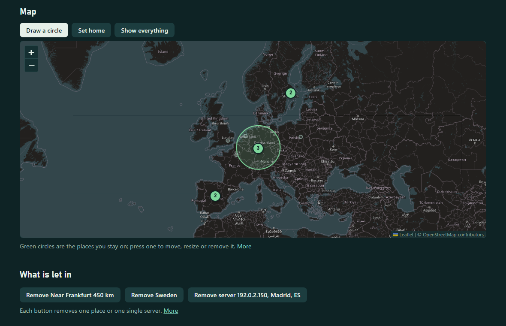
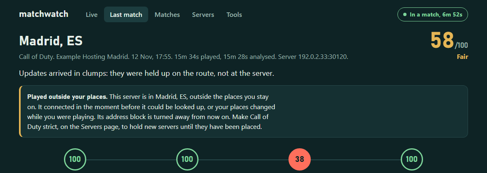
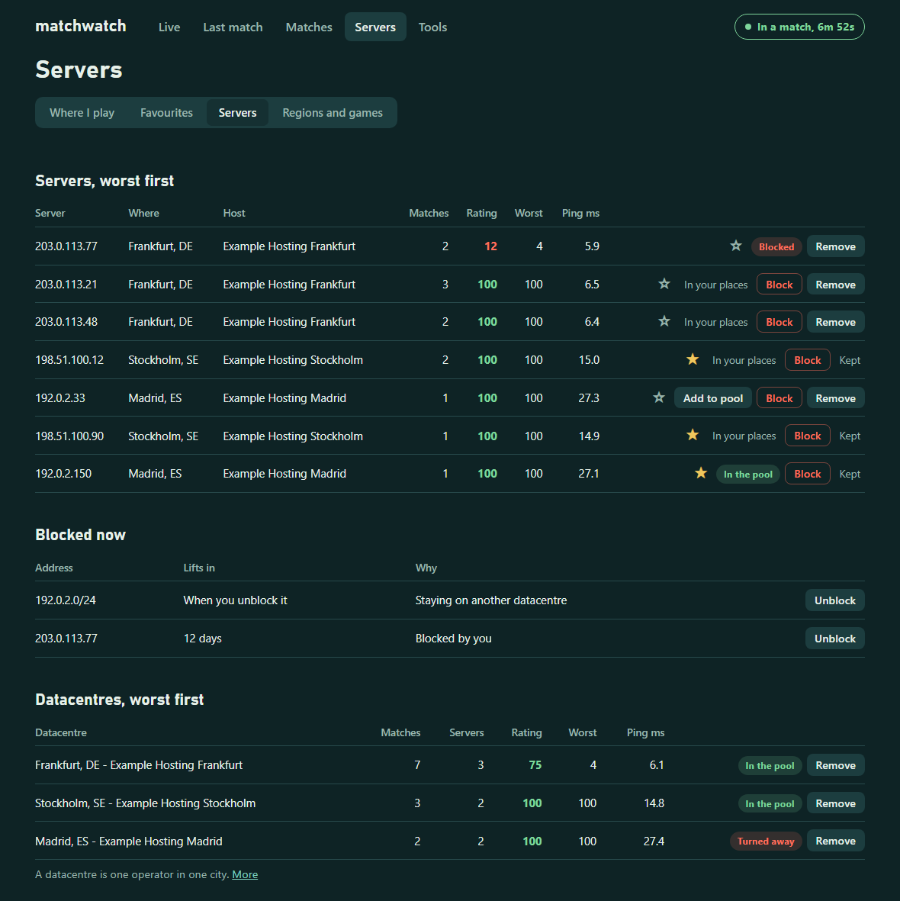
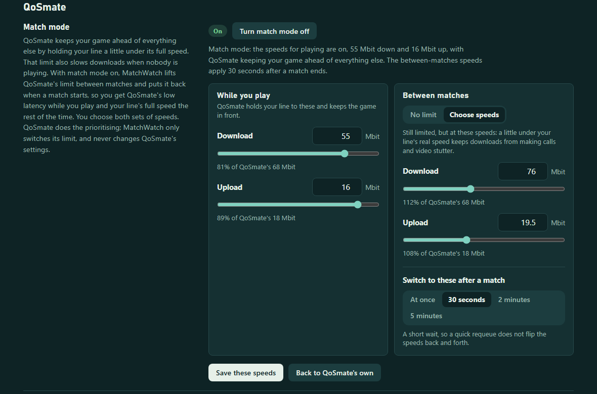
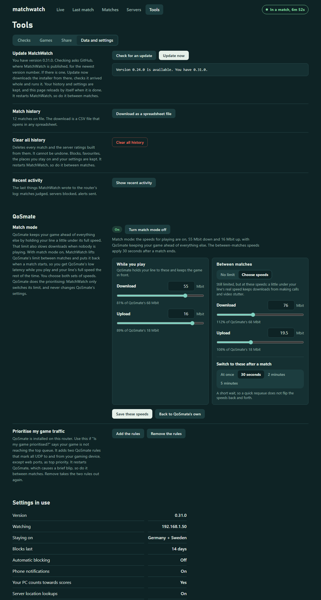

# MatchWatch

**Judges every online match from your OpenWrt router — v0.31.0 (pre-release)**

> **OpenWrt only.** MatchWatch runs on a router with [OpenWrt](https://openwrt.org/) firmware and appears inside LuCI, OpenWrt's web interface. It does not run on Windows, macOS, a games console, or a router with its maker's stock firmware. Nothing is installed on your PC or console.


MatchWatch watches your game's traffic as it passes through the router and tells you where a bad match came from: the game server, the route to it, your own line, or your PC. It lives in LuCI under **Services → MatchWatch**.

It works from packet timing only. Game traffic is never decoded, changed, delayed or injected, so it has no effect on your ping and nothing for anti-cheat to object to. Blocking servers and changing QoSmate rules do change what the router does, and only happen when you ask for them.

> **Status:** an early release, used daily on one router running OpenWrt 25.12, mostly with one game. Scores are a diagnostic estimate, not proof of a server's health. See [Limits](#limits).

## Contents

- [What it does](#what-it-does)
- [Install, update, remove](#install-update-remove)
- [The dashboard](#the-dashboard)
- [How a match is judged](#how-a-match-is-judged)
- [Alerts](#alerts)
- [Choosing your servers](#choosing-your-servers)
- [Games and voice chat](#games-and-voice-chat)
- [Sharing with other players](#sharing-with-other-players)
- [Tools](#tools)
- [QoSmate](#qosmate), including match mode
- [Commands](#commands)
- [Privacy and security](#privacy-and-security)
- [Limits](#limits)
- [For developers](#for-developers)

## What it does

**Judges the match**

- Spots a match on its own: a steady two-way UDP stream from your gaming device.
- Measures how evenly the server's updates arrive: tick rate, jitter, late, clumped and missing updates, stutters and freezes.
- Pings the server, the first hop inside your ISP and your PC throughout the match, to split the blame.
- Scores the server, the route, your line and your PC out of 100, says in one line what cost each its points, and names the weakest.
- Pings every stop on the route through the match and names the one where trouble starts.
- Has an "I felt that" button: press it when something feels off and it shows what the network was doing.

**Remembers**

- Keeps a full report and chart for every match, and ratings per server, datacentre and hour of the day.
- Keeps your favourite servers, grouped by game.
- Learns where each game has servers, from your matches and from files other players share.
- Lets you remove any match, server or datacentre, with favourites protected.

**Acts, when you ask**

- Blocks a bad server or datacentre, or keeps you to a pool of places you choose, turning whole regions away before the game tries them. Single servers from anywhere can be let through, and a game can be made strict so that no unplaced server ever connects.
- Alerts your phone through ntfy: when a match starts, when a poor server is ahead, after a bad match.
- Tests your line before you queue, traces the route to a server, and grades both from A+ to F.
- Checks that QoSmate is prioritising your game, and reports what its queues did in each match.
- Match mode: QoSmate holds your line to one pair of speeds while you play and another the rest of the time, both of your choosing.
- Updates itself from GitHub at the press of a button.

**Stays out of the way**

- Recognises around thirty popular games, and lets you name or add any other by its server port.
- Leaves voice chat alone: Discord and other calls are not recorded and can never be blocked.
- Makes share files you choose the contents of, item by item. Nothing is ever uploaded.
- Needs no account and no cloud service. It is a shell script, two awk programs and a LuCI app.

| The map: your places as circles and your servers by rating |
| --- |
|  |

| A match that got through, and why |
| --- |
|  |

| Live | Match report |
| --- | --- |
|  |  |

| Matches | Servers: where I play |
| --- | --- |
|  |  |

| Servers, datacentres and blocks |
| --- |
|  |

| Tools: checks, with grades | Tools: sharing |
| --- | --- |
|  |  |

| Match mode: the speeds while you play and between matches |
| --- |
|  |

| Tools: update, data and settings |
| --- |
|  |

The screenshots are made from invented data (`test/mockshots.py`). The game titles are real ones MatchWatch recognises; the addresses, hosts and matches are invented.

## Install, update, remove

MatchWatch only works on OpenWrt. You need:

- A router running OpenWrt 22.03 or newer, with LuCI. It must be the router your gaming device connects through, so it sees the game's traffic.
- SSH access to it as root.
- A few megabytes of free storage.

If your router runs its maker's own firmware, check whether OpenWrt supports it at [openwrt.org/toh](https://openwrt.org/toh/start) first.

### Install

SSH to the router and run one command:

```sh
uclient-fetch -O /tmp/matchwatch-install.sh https://raw.githubusercontent.com/ItsGix/matchwatch/main/dist/matchwatch-install.sh && sh /tmp/matchwatch-install.sh
```

That downloads the installer and runs it. It installs what is missing, starts MatchWatch and checks it can see traffic. Then, in LuCI:

1. Log out and back in, and open **Services → MatchWatch**. The menu entry only appears after a fresh login.
2. On the **Settings** tab, set **Device to watch** to your gaming PC or console. Until you do, MatchWatch watches every device.
3. Give that device a fixed address under Network → DHCP and DNS → Static Leases, so MatchWatch does not lose track of it.

Then play a match. It shows up on the Live page within about ten seconds.

To choose the device at install time instead, add its address to the end of the command: `... && sh /tmp/matchwatch-install.sh 192.168.1.50`.

If the router cannot download the file, fetch [`dist/matchwatch-install.sh`](dist/matchwatch-install.sh) on a computer and copy it over with `scp matchwatch-install.sh root@192.168.1.1:/tmp/`.

**What the installer does.** Read it before you run it: it runs as root. It installs `tcpdump` if missing, copies the program and the LuCI app into place, creates `/etc/config/matchwatch`, starts the service and runs a self-check. It works on both `apk` (OpenWrt 25.12) and `opkg` (older releases).

### Update

Open **Tools → Data and settings** and press **Check for an update**. If there is a newer version, **Update now** downloads the installer from this repository, checks it arrived whole against a published checksum, and runs it. The page then reloads itself with the new dashboard. History and settings are kept.

- Nothing is checked or downloaded until you press the button, unless you switch on **Tell me when a new version is out** under Alerts in Settings. Then the router looks once a day, the dashboard shows "Update available" at the top of every page, and your phone is told once per version. It never installs anything by itself.
- It refuses during a match, because updating restarts MatchWatch.
- Over SSH: `matchwatch update` checks, `matchwatch update now` installs.
- Versions before 0.22.0 have no update button: run the new installer the same way you installed.
- Updating from a version before 0.22.2, press Ctrl+F5 once afterwards; those versions' pages do not reload themselves.

**After a firmware upgrade.** History and settings survive, but the program is removed. Run the installer again.

### Remove

```sh
sh /tmp/matchwatch-install.sh remove
```

keeps your history and settings. Use `purge` instead of `remove` to delete those too.

## The dashboard

**Services → MatchWatch** has two tabs, Dashboard and Settings.

| Page | What is on it |
|---|---|
| **Live** | The match in progress: ping, update rate, jitter, late and missing updates, freezes, your PC's send rate and pauses, a two-minute chart, and the "I felt that" button. When the game starts connecting you somewhere, a banner says where, how far, and how that server has rated |
| **Last match** | The full report for one match: verdict, the four scores with the reason for each, a chart of the whole match, every figure, each stop on the route with where trouble started, what QoSmate's queues did, and your marks |
| **Matches** | Every recorded match, your latest session in a sentence, and ratings by hour of the day. Flags is how many moments you marked with "I felt that" |
| **Servers** | Four tabs. **Where I play**: the map, everything that is let in, and how each game is filtered. **Favourites**. **Servers**: servers, datacentres and blocks. **Regions and games**: pings to every region and where each game plays. Before 0.29.0 this was one long page: where each game plays, the places you stay on, datacentres, regions and servers with their ratings, and buttons to favourite, block, remove or stay |
| **Tools** | Checks, games, sharing, updating and data. See [Tools](#tools) |

The dashboard fetches fresh data every fifteen seconds and redraws only when something has changed. Longer explanations show their first sentence with a **More** link for the rest. Until your first match, the Live page lists the three steps to get started. Every page fits a phone; on a touch screen a circle is drawn with two taps, the middle and then the edge.

**Settings.** The device to watch, phone alerts, blocking and staying, and the advanced capture options. Saving restarts MatchWatch, which ends the recording of a match in progress, so change settings between matches.

**The dashboard without login.** Turn on "Dashboard without login" in Settings to also serve it at `http://<router address>/matchwatch/` to anyone on your network, for a phone or a second screen. That copy is view only: its one button is "I felt that", and nothing can be blocked or changed from it. It is off by default.

## How a match is judged

### What it measures

**Server.** A server sends updates on a fixed beat. MatchWatch measures how evenly they arrive:

- Update rate: the server's tick rate as seen on the wire.
- Timing jitter: average wobble around the beat.
- Late updates: arrived well after their slot.
- Arrived in clumps: held up somewhere, then delivered together. This points at the route.
- Missing updates: never arrived. Lost in transit or never sent.
- Stutters and freezes: gaps over 50 ms and 100 ms.

**Route.** One ping a second to the server during the match. If the server ignores ping but can be reached the way traceroute reaches it, it is probed that way every two seconds instead; servers ration those replies, so unanswered ones are not counted as loss. Failing that, the last hop that answers is used and judged more leniently.

**Your line.** One ping a second to the first hop inside your ISP.

**Your PC.** Whether your PC keeps sending without pauses, measured as its packets arrive at the router, plus a ping from router to PC if the PC answers. Only pauses over 100 ms are scored; they usually mean frame drops or a loading screen. Send jitter is shown but barely scored, because games tie their send rate to frame rate. Turn off "Count your PC towards scores" in Settings to leave your PC out of the overall score and verdict.

### Which stop on the way

When a route is rough, the next question is where. Through every match MatchWatch pings each stop between you and the server that answers, once every six seconds, and the match report lists them under Route: typical ping, jitter and loss for each stop.

If trouble starts at one stop and is still there at every stop after it, the report says so: "Trouble on the way starts at stop 7 (address): jitter 6.2 ms, and it is still there at every stop after it. The 6 stops before it were steady." If it starts at the first stop that answers, it says the trouble is at or near your own provider.

Routers answer pings when they have a moment, so a single rough stop with steady stops after it means nothing, and is not blamed. This is information to act on, such as showing your provider; it does not change any score.

### The four scores, and why

Each part gets a score out of 100, and the match report prints one short line under each saying what cost the most points, or "Nothing to fault". For example:

- Route 84: "Ping 73 ms: a long way to the server"
- Your PC 95: "4 pauses over 100 ms in what it sent"
- Server 24: "2.40% of updates went missing; 3 freezes over 100 ms"

Reasons are written when a match is scored, so matches recorded before 0.22.1 do not have them.

### What takes points off

| Score | Starts at 100 and loses points for | Most it can lose |
|---|---|---|
| Server | Timing jitter above 5% of one update | 30 |
| | Updates late or in clumps (4 points per 1%) | 25 |
| | Missing updates (12 points per 1%) | 35 |
| | Stutters over 50 ms, counted per ten minutes | 30 |
| | Freezes over 100 ms, counted per ten minutes | 20 |
| | Rough stretches beyond 5% of the match | 20 |
| Route | Ping jitter above 1 ms (6 points per ms) | 35 |
| | Lost pings (12 points per 1%; not counted for the traceroute-style probe) | 45 |
| | Ping above 40 ms (1 point per 2 ms) | 20 |
| Your line | Jitter above 3 ms to the first ISP hop (3 points per ms) | 35 |
| | Loss to the first ISP hop (6 points per 1%) | 45 |
| Your PC | Pauses over 100 ms in what it sends, counted per ten minutes | 45 |
| | Send jitter above 60% of one update | 10 |
| | Jitter or loss between router and PC | 80 |

So a steady route to a server a long way off scores in the low 80s for distance alone, and a handful of short pauses in a long match costs the PC a few points. Neither is a fault.

### The overall score and the verdict

- The overall score is 60% the weakest counted part and 40% a weighted average (server 45%, route 25%, line 15%, PC 15%).
- Grades: 85 and over Excellent, 70 Good, 50 Fair, below that Poor.
- **The game's own traffic is the ground truth.** When its packets arrived cleanly (server 80 or more), a lower route score is shown but not counted.
- The verdict names the weakest part.
- Scoring starts when steady game traffic begins, so the wait before a match is not counted. Sessions with under a minute analysed are not judged.
- A match only counts towards a server's rating when it lasted at least a minute and your own line was stable.

### "I felt that"

Press the button on the Live page (or the M key with the page focused) when something feels off: a shot that should have hit, a rubber-band, a death behind cover. MatchWatch looks at the six seconds before the press and says whether the server stalled, your ping jumped, your PC stopped sending, or nothing showed on the network at all. Marks appear on the chart, in the match report and in the history.

## Alerts

Install the ntfy app on your phone, subscribe to a hard-to-guess topic, and put `https://ntfy.sh/<your topic>` under Alerts in Settings. **Send a test alert** on the Tools page proves it works.

Alerts are one short line each, with no addresses in them. The full detail is always in the dashboard and in Recent activity on the Tools page.

| Alert | Reads like | When |
|---|---|---|
| Match started | Match started: United Kingdom, 5 ms. | Each match, if switched on |
| Lobby | Poor server ahead: United Kingdom, 5 ms. Rated 40/100 before. | A far or poor server, at most one a minute |
| Match ended | Match ended: 41/100 Poor. | After a bad match, or every match if switched on |
| New game | New game on server port 4444. Name it in MatchWatch, or mark it as not a game. | The first match on an unknown port |

**Match started** is for stepping away during a long queue. It fires when the steady game traffic starts, not in the lobby or on a loading screen, so it means "get back to your seat now". It waits up to about fourteen seconds for a ping; if the server does not answer, it is sent without one. It is only sent for named games, and is off by default.

**The lobby check.** When the game first contacts a server it recognises as a game server (a port labelled as a game, and either a host that matches the game or the same port or address block as an earlier match), MatchWatch looks up where it is, measures the ping and checks its history. The Live page shows the result, with a button to block the server before the match starts. Your phone is told when the server is noticeably further than your best datacentre or has rated badly. It needs at least one recorded match before it can recognise game servers.

A server turned away because you are staying somewhere else does not alert your phone, unless the lobby alert is set to "Always alert my phone". A game can try several servers in a minute.

## Choosing your servers

The game decides which server you get. MatchWatch cannot request one. What it can do is refuse servers, so the game has to place you elsewhere.

### Blocking

Blocks live in their own nftables table, so your firewall rules are untouched.

- Blocking takes effect on your next match. Never block the server you are playing on unless you want to be disconnected.
- Server addresses are reused, so blocks expire ("Blocks last" in Settings).
- Blocking many servers lengthens matchmaking.
- Automatic blocking is off by default. When on, a server is blocked after two counted matches averaging under 45.
- Individual addresses rotate, so ratings are also grouped by datacentre: one operator in one city. Blocking a datacentre blocks every /24 address block you have been placed on there. It can't know the datacentre's other blocks.

### Favourites

Press the star beside any server, on the Servers page, the Live page or a match report. The Servers page lists your favourites at the top, grouped by game and best rated first.

- A favourite is never blocked automatically, however it rates. You can still block one yourself.
- The lobby check tells you when the game is sending you to one.
- Favourites can be shared. Ones you take from someone else show under the same games, marked "Not played on yet" until you land on them.
- Clearing your match history keeps your favourites.

### Staying in a pool of places

Type places into the box on the Servers page, press a "Stay here" button, or use `matchwatch stay <places>`. You are then kept to servers in those places, whoever hosts them. Give one or several, separated by commas:

- **A city**: `milan`, `helsinki`. Servers within 150 km of it are allowed. Cities in the regions table work offline; any other city name is looked up with the Open-Meteo geocoding service, which is sent only the name you typed.
- **A country**: `italy` or `it`.
- **An area**: `western-europe`. `matchwatch places` lists them.
- **A datacentre number** from `matchwatch datacentres`.

Several places make one pool, and the game picks among them. A bigger pool means shorter queues.

How it works:

- Every address block you have played on outside the pool is blocked at once.
- When the game reaches for any other server, MatchWatch looks up where it is and turns it away if it is outside the pool, before measuring anything. You are refused in the lobby, not thrown out of a match later.
- Changing the pool keeps the turn-aways that still apply.
- A match in progress is never cut off. If you start staying during a match on a server outside your places, that server is turned away once the match has ended.

What to expect:

- The game decides which regions to offer you. Places it already gives you work well. Far ones may take several failed connections, or never come up.
- It applies only to servers MatchWatch recognises as game servers. If a game shows as "Game on port N", name it first: unnamed games are left alone.
- Server locations come from a public lookup and are occasionally wrong.
- A place is dropped from the pool, and you are told, if its last three counted matches average under the warning rating. When the pool is empty, staying ends.

### The map

The Servers page has a map of everything MatchWatch knows, beside the box where you type places.

- **Your places** are green circles. Press **Draw a circle**, press where the middle should be, drag outwards and let go; MatchWatch says how many of the servers you have played on are inside before you confirm. Press an existing circle to move it by its middle, resize it by its edge, or remove it.
- **Servers you have played on** are round markers coloured by how they rated: green, amber or red. A number means several in one city, and a faded marker is outside your places. Press one for its servers, with the favourite, Add to pool and Block buttons.
- **Datacentre regions** are small hollow dots; hover for the ping and its grade. Places learned from share files are small solid dots.
- **Set home** marks roughly where you are, and during a match a dashed line runs from home to the server. Home is remembered only by your browser; it is not stored on the router.
- A drawn circle is an ordinary place in the pool, named after the nearest datacentre city ("Near Frankfurt 450 km"), between 25 and 3000 km across. Whole countries and areas are still typed in the box; they are listed under the map, since they are not circles.

The map pictures are tiles from OpenStreetMap, fetched by your browser while the map is on screen. The map library, Leaflet, is installed on the router with MatchWatch, so nothing else is loaded from outside.

### Single servers in the pool

Sometimes one server outside your places is worth keeping: a favourite, or one you played well on last night. While you are staying on places, **Add to pool** appears beside every server in your favourites and the server list, and on each match report. It lets that one server through, whatever region it is in. A server already inside your places shows "In your places" instead, since there is nothing to add. The region lock itself is unchanged: everything else outside your places is still turned away.

- Only the exact address is allowed. Its neighbours in the same datacentre are still refused, so nothing you did not choose gets in. Games do move players between neighbouring addresses, so you may not be offered the same one often.
- The servers you have added are listed under your places at the top of the Servers page, each with a Remove button.
- An allowed server is never blocked automatically. Blocking it yourself takes it back out of the pool.
- The game still decides. Allowing a server means it will not be refused, not that you will be sent to it.

From the command line: `matchwatch allow`, `matchwatch allow add <ip>`, `matchwatch allow remove <ip>`.

### When a server is turned away

How soon staying on places acts on a game depends on how sure MatchWatch is that a server belongs to that game. The Servers page shows which applies to each game you have played, under "How each game is filtered".

| The game is | A server outside your places is turned away | You need to |
|---|---|---|
| Known by port and by who hosts it (Call of Duty, Valorant, League of Legends, Overwatch 2, War Thunder, iRacing) | From the first one the game tries, once it has been looked up | Nothing |
| Hosted by a company with a published address list (Call of Duty on Vultr) | Before the game even tries it | Nothing |
| Known by port alone (Fortnite, Apex Legends, Rocket League and most others) | Only on a port or address block where you have already played a match | Play one match, or make the game strict |
| Any named game you made strict | Before it can connect, every time | Press Make strict |
| Not named ("Game on port N") | Never | Name it first |

The table on the Servers page lists the games you have played; **Show all games** lists every game MatchWatch recognises, so you can check a new one, and make it strict, before your first match. And when a server outside your places is let through because its game is known by port alone, the Live page says so, with a button to make that game strict. If you then play the match there, its report opens with "Played outside your places" and the reason it was not turned away.

The middle row exists because other traffic uses the same ports. A port alone is not proof of a game, so MatchWatch waits for a match there before refusing anything, unless you tell it to be strict.

### Strict games

Normally a server MatchWatch has not seen before gets its first packets through while it is being looked up, and is turned away a moment later if it is outside your places. For most games that is fine. Where it is not, make the game **strict**: on the Servers page, under Strict games, press **Make strict** beside it.

- Every new server on that game's ports is then held until MatchWatch has placed it, usually well under a second. A server outside your places never gets a packet through. One inside them, or one that turns out not to be a game server at all, is let through and not asked about again.
- It applies only to your gaming device, only to that game's server ports, and only while you are staying on places.
- **Voice chat is never held.** Ports that voice chat uses are cut out of what is held, and a game that lives mostly on voice chat ports, such as Roblox, cannot be made strict.
- **It fails open.** If MatchWatch is stopped, restarting, or cannot look a server up, nothing is held.
- A match in progress keeps its server when you change the pool.
- A server you added to the pool yourself is always let through. If a game needs a matchmaking server that sits outside your places, add it with **Add to pool**.

From the command line: `matchwatch strict` lists the games, `matchwatch strict on "Call of Duty"` and `strict off` switch one.

### Whole regions, ahead of time

Learning servers one at a time is slow: the game tries one, waits, gives up and tries the next, and a single city can have dozens of server ranges. So when you stay on places, MatchWatch also refuses every address range it knows to be outside them, before the game tries any.

It knows from lists that hosting companies publish themselves, saying which of their address ranges is in which city. One is built in: Vultr, which hosts every Call of Duty server seen so far (several hundred ranges). The router downloads the list when you start staying and once a week after; nothing about you is sent.

- **It tells you which games this covers.** The Servers page names the hosts and the games they are known to carry ("Vultr (Call of Duty)"). Any other game is still turned away one server at a time.
- **It warns you when a place has no servers.** Choose a country with none, and the Servers page says you will not find a match with only that place in the pool, and offers the nearest places that do have servers, each with an Add button. For a game on a host MatchWatch has no list for, it cannot know this in advance.
- **Only your gaming device's game traffic is refused** (UDP from the device you chose to watch). Web sites on the same hosting company, and every other device in the house, are untouched. With no device chosen, this part is skipped.
- **A range whose city cannot be placed is left alone**, and so is any range holding a match in progress.
- **Other hosts.** If a game's host publishes such a list, add it to `/etc/matchwatch/geofeeds.local` as `name|address` and run `matchwatch ranges refresh`. Many hosts, including the large clouds, do not publish one in this form.
- **Stop staying** removes all of it. "Turn whole regions away ahead of time" in Settings switches it off.

A pool far from home can still mean a long queue: the game decides who to match you with.

### Where each game plays

The Servers page lists where every game has servers: one row per game and place, with the host, how many server networks are known there, your matches and rating, and whether that place is in your pool.

Your own router only learns the places a game offers you, which are mostly near home. The rest of the world comes from other players, through the "Game servers by place" section of a [share file](#sharing-with-other-players). Places from others are marked "Shared with you".

- When you stay on places, a game with nothing known inside them is called out, with where it is known to have servers.
- Shared entries are information. Nothing is blocked or allowed because of them.

### Every region

A table on the Servers page shows the ping from your router to about thirty datacentre regions worldwide, each with a grade from A+ to F, your matches there and how they rated. It pings the public test server Vultr runs in each of its datacentres, refreshes every six hours and on "Measure now". It is not a complete list of where a game has servers.

### Removing things

Every row you might want gone has a **Remove** button, and each asks you to press twice.

- **A match**: that match and its report.
- **A server**: the server and every match on it.
- **A datacentre**: the datacentre, its servers and their matches.
- **A rating someone shared with you**, **a game you added** and **a block**: on their own rows.

Ratings, the regions table, the hour chart and the recap are rebuilt without what you removed. A favourite cannot be removed by accident: it shows **Kept** where Remove would be, and removing its datacentre is refused. Take the star off first.

## Games and voice chat

### How a game is recognised

MatchWatch never looks inside packets, so it recognises a game from two things it can see: the **port** on the game's server, and, where a port is shared, **who hosts the server**. The list ships with MatchWatch as a plain text file. Nothing is downloaded: it only changes when you update, name a game yourself, or import names from a share file.

| | |
|---|---|
| By port and host | Call of Duty, Valorant, League of Legends, Overwatch 2, Roblox, War Thunder, iRacing |
| By port | Fortnite, Apex Legends, Rocket League, Counter-Strike 2, Dota 2, Deadlock, Team Fortress 2, Destiny 2, Minecraft (Bedrock), Rust, ARK, DayZ, Palworld, Among Us, Genshin Impact, Street Fighter 6 |
| By port, from unofficial figures | Battlefield, Rainbow Six Siege, Escape from Tarkov, World of Tanks, EA Sports FC, Smite, Paladins |

This list cannot be complete:

- Many publishers do not publish their server ports. PUBG, Marvel Rivals, Helldivers 2, The Finals and Dead by Daylight are examples.
- Several games share a range. Counter-Strike 2, Dota 2 and Destiny 2 all use Steam's network, so they show under one "Steam games" label.
- Games hosted player-to-player, such as GTA Online and most Nintendo Switch games, have no server port to recognise.
- Final Fantasy XIV, World of Warcraft and Minecraft Java do not use UDP for play, so MatchWatch does not see them as matches.

### Games it does not recognise

A game not on the list is still detected and rated, as "Game on port N", provided it looks like a game: at least two minutes of play and a steady stream of updates. Calls, launchers and other programs use unknown ports too; a stream shorter than that, or with too many updates missing, is not recorded. It is listed under **Skipped, not recorded** on the Tools page, where you can name it if it was a game after all.

The first time an unknown game is recorded, a banner appears on the Live and Matches pages with a box to name it, a **Not a game** button, and a cross to hide the notice. With phone alerts set up, your phone is told too.

You do not have to wait for a match. **Add a game** on the Tools page takes a server port or a range, a name and, where the range is shared, a word from the name of the company hosting the servers. A range over 2000 ports wide must have one.

Name it once and every match on that port, past and future, carries the name. Until a game has a name, staying on places, the lobby check and automatic blocking leave it alone. That is deliberate: MatchWatch only turns servers away when it is sure they are a game.

### Voice chat is left alone

Voice chat is not a match. MatchWatch does not record it, does not show "In a match" for it, sends no alerts about it and can never block it. Recognised as voice: Discord, TeamSpeak, Mumble, Valorant's voice servers, and the ports consoles and games use for party chat.

Discord's voice servers use the high ports from 50000 upwards, and so does Roblox. MatchWatch tells them apart by host. This check needs "Look up where servers are" switched on.

A block you add by hand applies to whatever address you give it. If you use the QoSmate fix, voice chat from your gaming device is prioritised along with the game, because those rules cover all of that device's UDP.

## Sharing with other players

One person cannot research every game's ports or try every datacentre. A share file lets MatchWatch users pass what they have learned to each other. It is a small text file you can read in any editor, post on a forum or send to a friend. Make one, or take one in, on the **Tools → Share** tab.

### What a share file can hold

| Section | What it is | What importing it does |
|---|---|---|
| Game names | The games you have named, with their server ports and, where needed, who hosts them | Adds them to your own names. A name you gave yourself always wins |
| Places you stay on | Your pool of cities, countries and areas | Adds them to your pool and turns staying on |
| Game servers by place | Where each game has put you or tried to: the game, the server network, its city, country and host, your matches there and their rating | Adds them to **Where each game plays**, marked "Shared with you". Nothing is blocked or allowed because of them |
| Favourite servers | Servers you have starred, or any you pick by game, rating, place or number of matches | Adds them to the other person's favourites under the same games. They can also choose **Stay near those servers**, which adds the servers' cities to their pool |
| Network ratings | How each server network has rated for you: number of matches and average rating | Shows them in a table, and the lobby check mentions one when you land on that network for the first time |
| Ping hosts | Extra test hosts for the regions table, for hosting companies other than Vultr | Adds them to the regions table and measures them |
| Thresholds | Your rating and capture thresholds | Sets yours to match, and restarts MatchWatch |

### Choosing exactly what to share

"Choose what to share" lists everything you could share, and every item has its own tick: each game name, each place, each server network, each ping host and each threshold. Nothing goes in unless it is ticked.

- **All** and **None** on every section.
- **Favourite servers** starts with your starred servers ticked. Switch it to every server you have played on, then narrow the list by game, rating, country or city, and number of matches.
- The dropdowns choose what is listed, and never untick anything. A line under the list says how many ticked items are not currently shown.
- Networks with only one match start unticked, because one match says little. Thresholds start unticked.
- **A note** can be added for whoever gets the file. It is the only free text in the file.

The box underneath is the file itself and changes as you tick. Save it or copy it from there. When you take a file in, you choose by section; to take only some lines, delete the others from the text before checking it.

### What keeps it safe

- **Nothing is uploaded.** You make the file and you decide who gets it.
- **Nothing about your home goes in.** No device name, no LAN or ISP address, no match times. The whole file is shown to you before you save it.
- **Every imported line is checked.** Lines that are malformed, or that could do harm, are left out and listed. A game label covering more than 2000 ports must name the company hosting its servers; otherwise it would take unrelated traffic for that game.
- **Other people's ratings never block anything.** They are shown, with a Block button beside each, and that is all.
- **Checking a file changes nothing**, and **Undo the last import** puts things back as they were.
- A share file cannot turn on automatic blocking, change your phone alerts address, or choose the device to watch.

### From the command line

```
matchwatch share export > mine.txt            # everything
matchwatch share export games favourites > mine.txt
matchwatch share check theirs.txt             # what is in it; changes nothing
matchwatch share import theirs.txt            # or: ... import theirs.txt games
matchwatch share import theirs.txt favourites favplaces   # their favourites, and stay near them
matchwatch share undo
matchwatch share forget                       # remove ratings other people shared with you
```

The [`packs/`](packs/) folder is for game packs anyone can use: share files with only a `[games]` section. [`packs/README.md`](packs/README.md) has the format and what a pack needs before it is accepted.

## Tools

The Tools page has four tabs. Each tool says what it does beside its button.

**Checks**

- **Check MatchWatch is working.** Confirms the programs it needs are present and that it can see your device's traffic. Takes five seconds and changes nothing.
- **Test your line.** Twenty seconds of pings from the router to your provider's first hop and two public servers, with no game needed, so you can tell before you queue whether your connection is steady. Trouble seen on every target is blamed on your line; trouble with one target is not.
- **Is my game prioritised?** Needs [QoSmate](#qosmate) and a match in progress. Changes nothing.
- **Phone alerts.** Sends one test message.
- **Route to a server.** Traces the path to any server in your history, to compare with the route in a match report.

**Grades.** Tests get a letter from A+ to F.

| Test | Graded on | A+ | A | B | C | D | E |
|---|---|---|---|---|---|---|---|
| Line test | Loss, jitter and slow replies shared by every target, as a score | 97+ | 90 | 80 | 70 | 55 | 40 |
| Route trace, region pings | Distance alone: the ping in ms | to 15 | 30 | 50 | 80 | 120 | 180 |

A trace is one sample, so it shows how far a server is, not how steady the route is. A match report does that. If the server does not answer the trace, it gets no grade.

**Games**

- **Name a game** and **Add a game**: see [Games it does not recognise](#games-it-does-not-recognise).
- **Your games.** Everything you have added, named or imported, each with a Remove button.
- **Skipped, not recorded.** Streams from the last six hours that were left out, as voice chat or because they did not look like a game.

**Share**: see [Sharing with other players](#sharing-with-other-players).

**Data and settings**

- **Update MatchWatch**: see [Update](#update).
- **Match history.** Downloads your matches as a spreadsheet (CSV) file.
- **Clear all history.** Deletes every match and the ratings built from them. It cannot be undone. Blocks, favourites, the places you stay on and your settings are kept.
- **Recent activity.** The last things MatchWatch wrote to the router's log.
- **QoSmate priority**: see [QoSmate](#qosmate).
- **Settings in use**, at a glance.

## QoSmate

[QoSmate](https://github.com/hudra0/qosmate), by hudra0, is a separate package that prioritises traffic on OpenWrt. It is what gives a game low latency on a busy line; MatchWatch measures, and QoSmate does the work. MatchWatch runs without it; with it, four things are added. Without it, the QoSmate tools say so and link to it.

**Match mode.** QoSmate keeps your game ahead of everything else by holding your line a little under its full speed, so that any queue forms in your router, where QoSmate can put the game first. The cost is that the limit is there all day, slowing downloads when nobody is playing, and on a slow line or a small router that cost is large. With match mode on, MatchWatch switches the limit between two sets of speeds, and you choose both.

| | What it is | If you leave it alone |
|---|---|---|
| **While you play** | The download and upload speeds QoSmate holds your line to during a match | QoSmate's own rates, and it follows them if you change them in QoSmate |
| **Between matches** | The speeds for the rest of the time: no limit, or speeds you choose | No limit |
| **Switch after a match** | How long after a match ends before the between-matches speeds take over: at once, 30 seconds, 2 minutes or 5 minutes | 30 seconds |

Each speed has a box to type megabits into and a slider beside it, kept in step. The slider works in percent of QoSmate's own rate, so "80%" means 80% of what you set in QoSmate. Nothing changes until you press **Save these speeds**, and **Back to QoSmate's own** undoes your choices.

- The speeds for playing come on when the game first reaches for a game server, or at the latest when the match itself starts.
- MatchWatch never writes QoSmate's settings and does not restart it. It gives the queue a rate, or "unlimited", and nothing else, so no option you chose in QoSmate is lost and there is no blip.
- It fails towards QoSmate's own limits. Stopping or restarting MatchWatch, switching match mode off, or anything that restarts QoSmate all put QoSmate's own rates back.
- The Live page says which speeds are in force, and Recent activity records each switch.
- It needs QoSmate switched on and in one of its cake modes. Turn it on under Tools, Data and settings, or in Settings. It is off by default.

Over SSH: `matchwatch matchmode on`, `matchmode off`, and `matchwatch matchmode speeds <playing down> <playing up> <between down> <between up> [seconds]`, in kbit, where 0 means the default for that slot.

Two things worth knowing when you choose. A speed for playing above what your line really delivers gives QoSmate nothing to work with: the queue moves to your provider and the game is no longer in front. And lowering the speed for playing below a little under your line's real speed does not lower your latency further; it only slows everyone else.

**Did QoSmate do its job in this match?** In one of QoSmate's cake modes, each match report has a "QoSmate in this match" section. MatchWatch reads QoSmate's queue counters when the match starts and ends, and the longest wait every five seconds in between. It says in a sentence whether the game's own queue dropped or delayed anything, and whether other traffic had to be held back while the game went ahead. It only reads. In HFSC mode the section is left out.

**Is my game prioritised?** Once per match, and on demand, MatchWatch checks that the game's traffic is in the top priority queue, by comparing that queue's packet count with what the game is sending.

**Prioritise my game traffic.** If it is not, this button (or `matchwatch qos fix`) adds two QoSmate rules, `matchwatch_out` and `matchwatch_in`. They mark all UDP to and from your gaming device, except web ports 80 and 443, as top priority. QoSmate is then restarted, which causes a brief blip, so do it between matches. "Remove the rules" takes them out again. This only happens when you ask for it. If you already have rules named `Game_Outbound` and `Game_Inbound`, made from commands an older version printed, the fix adopts and renames them, and removing then deletes them.

## Commands

Everything is also available over SSH:

| Command | What it does |
|---|---|
| `matchwatch live` | The match in progress, updated every second |
| `matchwatch last` | Full report for the last match, with the route trace |
| `matchwatch history` | Recent matches. Add a number for more, or a server IP for one server |
| `matchwatch servers` / `datacentres` | Everything seen, worst first |
| `matchwatch hours` / `recap` / `games` | Ratings by hour, the latest session, games seen |
| `matchwatch block <ip> [days]` | Block a server (14 days by default, `0` = until unblocked) |
| `matchwatch unblock <ip>` or `all` | Remove a block |
| `matchwatch block-dc <n>` / `unblock-dc <n>` | Block or unblock the address blocks seen in datacentre n |
| `matchwatch blocklist` | What is blocked and for how long |
| `matchwatch fav` / `fav add <ip>` / `fav remove <ip>` | Your favourite servers |
| `matchwatch stay <places>` / `stay off` | Keep to a pool of places, separated by commas |
| `matchwatch stay add <places>` / `stay remove <n>` | Change the pool |
| `matchwatch allow` / `allow add <ip>` / `allow remove <ip>` | Single servers let through the places you stay on |
| `matchwatch strict` / `strict on <game>` / `strict off <game>` | Hold every new server of a game until it has been placed |
| `matchwatch stay circle <lat> <lon> <km>` | Add a circle to the pool, as the map does |
| `matchwatch places` | The areas you can stay on |
| `matchwatch ranges [refresh]` | The hosting companies' address lists used to turn whole regions away |
| `matchwatch regions [measure]` | Ping every region, nearest first |
| `matchwatch game name <port or lo-hi> <name> [hosts] [voice]` / `game remove` | Name a game by port, or take a name away |
| `matchwatch mark` | Flag this moment, same as the "I felt that" button |
| `matchwatch qos` | During a match: is the game in QoSmate's top priority queue? |
| `matchwatch qos fix` / `qos unfix` | Add or remove QoSmate rules that prioritise your gaming device |
| `matchwatch matchmode` / `matchmode on` / `matchmode off` | With QoSmate: one pair of speeds while you play, another between matches |
| `matchwatch matchmode speeds <down> <up> <down> <up> [seconds]` | Choose those speeds, in kbit, and how soon after a match they switch |
| `matchwatch device [<ip>\|all]` | List the devices on your network and choose which to watch |
| `matchwatch doctor` | Checks that capture works. Changes nothing |
| `matchwatch update` / `update now` | Says whether GitHub has a newer version; with `now`, downloads and installs it |
| `matchwatch forget match <start>` / `server <ip>` / `dc <n>` | Removes one match, server or datacentre. Favourites are kept |
| `matchwatch clear-history` | Forgets every recorded match. Blocks and settings are kept |
| `matchwatch share export` / `check` / `import` / `undo` / `forget` | Make, inspect or take in a share file |

Settings live in `/etc/config/matchwatch`. To change one over SSH: `uci set matchwatch.main.<option>=<value>`, `uci commit matchwatch`, then `/etc/init.d/matchwatch restart`.

## Privacy and security

- The dashboard and every button sit behind the LuCI login. Each action is checked against the logged-in account's permissions, with looking and changing granted separately.
- The optional dashboard without login is view only and off by default.
- Keep LuCI on a network you trust and never expose it through a public port forward.

What leaves your router, and when:

| What | Where it goes | When |
|---|---|---|
| A game server's IP address | ip-api.com, to find where the server is | Each new server. "Look up where servers are" in Settings turns it off (staying and the lobby check need it on) |
| A city name | Open-Meteo, to place it on the map | When you stay on a city not in the regions table, and for cities in a hosting company's list |
| A request for a hosting company's address list | That company (Vultr) | When you start staying, then weekly |
| A request for one small version file, then the installer | This repository on GitHub | When you press Check for an update or Update now. Once a day too, if you switched on the update notice |
| Requests for map pictures, from your browser and not the router | OpenStreetMap's tile servers | While the map on the Servers page is on screen. They show which part of the world you are looking at |
| Your alerts | The ntfy address you set | Only if you set up phone alerts |

Nothing about you or your matches is in any of those except the alerts you asked for. Share files are only made when you ask, are shown to you in full, and are never uploaded.

Updating downloads the installer and runs it as root, exactly as installing by hand does. The project has not had a security audit.

**Storage.** Everything MatchWatch keeps is small: the match history is trimmed to its newest 5,000 matches (under 2 MB), and the lists of where games play are capped at a few thousand lines.

## Limits

- Any steady two-way UDP stream that is not recognised as voice chat can be recorded as a match. "Only look at this traffic" under Advanced narrows capture, for example `port 3074 or portrange 30000-45000` for Call of Duty.
- IPv4 only.
- When neither the server nor any hop near it answers probes, uneven delivery can't be split between server and route. The report says so.
- Scores were first calibrated from simulated traffic. Expect the thresholds to need tuning against real matches.
- Up-front refusal of whole regions covers only hosts with a published address list: today that is Vultr.
- Tested on one router and mostly one game. Seen working there: capture and scoring, phone alerts, the lobby check, staying on places against real matchmaking, the QoSmate match record, and updating from the dashboard. Not yet proven: whether refusing whole regions ahead of time shortens matchmaking, the filter for unnamed ports on a real stream, and the QoSmate fix buttons. [`CLAUDE.md`](CLAUDE.md) keeps the current list.

## For developers

| Path | Purpose |
| --- | --- |
| `files/matchwatch` | The service and CLI, including the actions the dashboard's buttons run (POSIX shell for BusyBox ash) |
| `files/analyze.awk` | Packet timing, flow detection and scoring |
| `files/report.awk` | Reports and JSON exports |
| `files/matchwatch.config` | Default settings, installed as `/etc/config/matchwatch` |
| `files/public.html` | Shell page for the dashboard without login |
| `files/*.list` | Region probes, places, country centres, hosting companies' address lists and game-port labels |
| `luci-app-matchwatch/htdocs/` | The dashboard, and the LuCI Dashboard and Settings pages. `leaflet.js` and `leaflet.css` there are Leaflet 1.9.4, unchanged, under its BSD 2-Clause licence |
| `luci-app-matchwatch/root/` | LuCI menu entry, permissions and the rpcd backend the buttons call |
| `packs/` | Community game packs and their format |
| `build.py` | Builds the one-file installer and `dist/version` |
| `dist/` | The installer, and the version file routers read when checking for an update |
| `test/` | Simulated traffic, stand-ins for router tools, a test site for the view-only dashboard, and `mockshots.py`, which makes the screenshots |

After changing anything in `files/` or `luci-app-matchwatch/`, rebuild:

```sh
python3 build.py
```

Whatever is on `main` in `dist/` is what every router's Update button installs, so install a build on a router before pushing it.

Replay a simulated match through the engine (needs BusyBox):

```sh
python3 test/gen.py good | busybox awk -v REPLAY=1 -v DATA=/tmp/none -v RUN=/tmp/none -f files/analyze.awk
```

Scenarios: `good`, `badserver`, `clump`, `badpc`, `frag`, `lobby`, `noise`, `fps`, `handshake`, `short`. [`CLAUDE.md`](CLAUDE.md) has the developer notes and the list of what has been proven on a real router.

## Thanks

- [QoSmate](https://github.com/hudra0/qosmate) by hudra0 does the traffic prioritising that MatchWatch checks, records and, in match mode, switches. MatchWatch contains none of its code and changes none of its settings.
- [Geomate](https://github.com/hudra0/geomate), also by hudra0, showed how well drawing regions on a map works for choosing game servers. MatchWatch's map and strict mode follow its example; the code is MatchWatch's own.
- [Leaflet](https://leafletjs.com/) (BSD 2-Clause) draws the map, with map pictures from [OpenStreetMap](https://www.openstreetmap.org/copyright) contributors.

## Licence

This is an experimental personal project. Issues and feedback are welcome. **No open-source licence has been chosen yet**, so the source being public does not grant rights to reuse or redistribute it.
