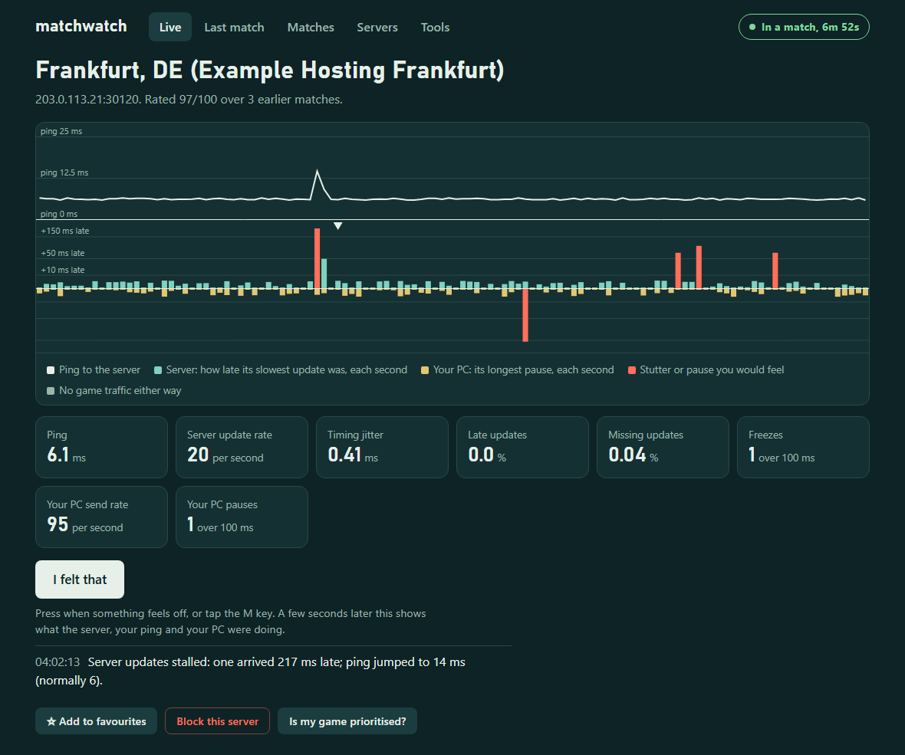
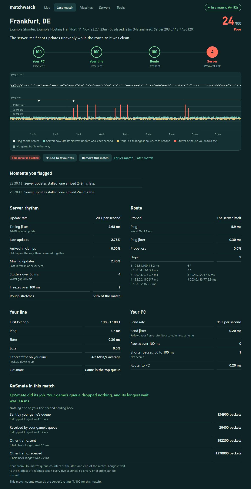
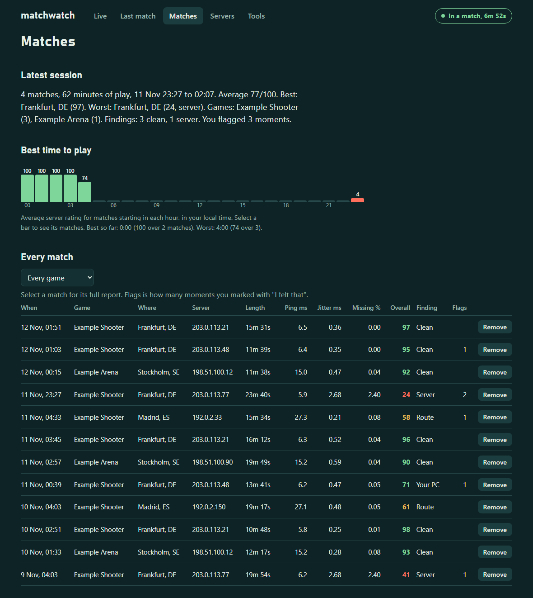
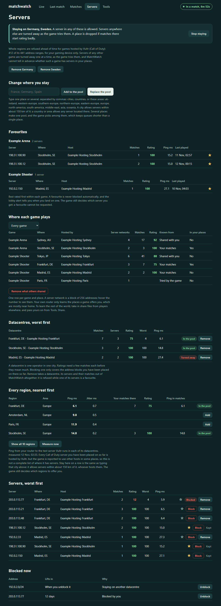
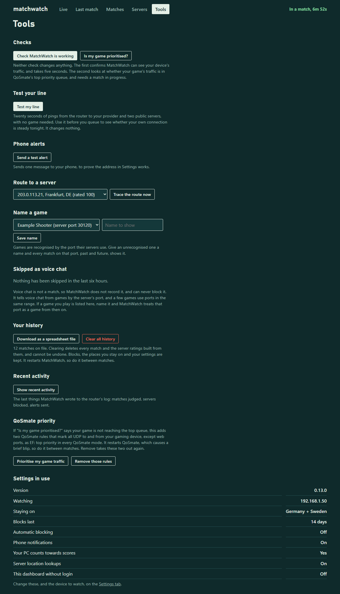
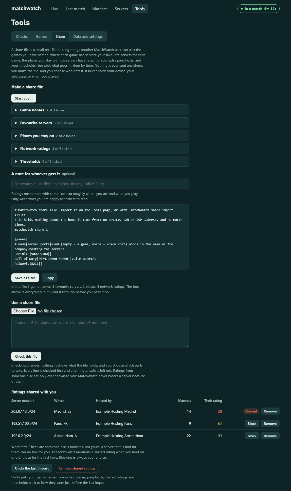

# MatchWatch

**Judges every online match from your OpenWrt router — v0.21.1 (pre-release)**

> **OpenWrt only.** MatchWatch runs on a router with [OpenWrt](https://openwrt.org/) firmware and appears inside LuCI, OpenWrt's web interface. It does not run on Windows, macOS, a games console, or a router with its maker's stock firmware. Nothing is installed on your PC or console.



MatchWatch watches your game's traffic as it passes through an OpenWrt router and tells you where a bad match came from: the game server, the route to it, your own line, or your PC. It lives in LuCI under **Services → MatchWatch**.

It works from packet timing only. Game traffic is never decoded, changed, delayed or injected, so it has no effect on your ping and nothing for anti-cheat to object to. Blocking servers and changing QoSmate rules do change what the router does, and only happen when you press the button for them.

> **Status:** an early release, tested with one game on one router running OpenWrt 25.12. Capture, scoring, the dashboard and the commands behind every button have run on that router. The LuCI app is new in 0.10.0. Scores are a diagnostic estimate, not proof of a server's health. See [Limits](#limits).

## What it does

- Spots a match on its own: any steady two-way UDP stream from your gaming device.
- Measures how evenly the server's updates arrive: tick rate, jitter, late, clumped and missing updates, stutters and freezes.
- Pings the server, the first hop inside your ISP and your PC throughout the match, to split the blame.
- Gives each of the four links a score out of 100 and names the weakest.
- Keeps a history with a full report and chart for each match, and ratings per server and datacentre.
- Has an "I felt that" button: press it when something feels off and it shows what the network was doing.
- Can block bad servers or datacentres, or keep you to a pool of places you choose.
- Keeps your favourite servers, grouped by game, and never blocks one automatically.
- Recognises around thirty popular games, asks you to name any it does not know, and lets you add your own by port.
- Lets you remove any match, server or datacentre from its records, with favourites protected.
- Makes share files you can pass to other players: game names, favourite servers, places, ratings and thresholds, picked item by item. Nothing is ever uploaded.
- Leaves voice chat alone: Discord and other calls are not recorded and can never be blocked.
- Can alert your phone through ntfy, including the moment a match starts, for when you have stepped away during a queue.
- Can test your line before you queue, and check that QoSmate is prioritising your game.
- Needs no account and no cloud service. It is a shell script, two awk programs and a LuCI app.

| Live | Match report |
| --- | --- |
|  |  |

| Matches | Servers |
| --- | --- |
|  |  |

| Tools | Sharing |
| --- | --- |
|  |  |

The screenshots are made from invented data (`test/mockshots.py`); the addresses and matches in them are not real.

## Install

MatchWatch only works on OpenWrt. You need:

- A router running OpenWrt 22.03 or newer, with LuCI. It must be the router your gaming device connects through, so it sees the game's traffic.
- SSH access to it as root.
- A few megabytes of free storage.

If your router runs its maker's own firmware, check whether OpenWrt supports it at [openwrt.org/toh](https://openwrt.org/toh/start) first.

1. SSH to the router and download the installer:

   ```sh
   uclient-fetch -O /tmp/matchwatch-install.sh https://raw.githubusercontent.com/ItsGix/matchwatch/main/dist/matchwatch-install.sh
   ```

2. Run it with your gaming PC's or console's IP address:

   ```sh
   sh /tmp/matchwatch-install.sh 192.168.1.50
   ```

   Leave the address off to watch every device, or choose the device later in LuCI.

3. Log out of LuCI and back in, then open **Services → MatchWatch**. The menu entry only appears after a fresh login.

4. Give your gaming device a fixed address in LuCI under Network → DHCP and DNS → Static Leases, so MatchWatch does not lose track of it.

Then play a match. It shows up on the Live page within about ten seconds.

If the router cannot download the file, fetch [`dist/matchwatch-install.sh`](dist/matchwatch-install.sh) on a computer and copy it over with `scp matchwatch-install.sh root@192.168.1.1:/tmp/`.

**What the installer does.** Read it before you run it: it runs as root. It installs `tcpdump` if missing, copies the program and the LuCI app into place, creates `/etc/config/matchwatch`, starts the service and runs a self-check. It works on both `apk` (OpenWrt 25.12) and `opkg` (older releases).

**Updating.** Run the new installer the same way. History and settings are kept. Settings from versions before 0.10.0 are carried over automatically.

**After a firmware upgrade.** History and settings survive, but the program is removed. Run the installer again.

**Removing.**

```sh
sh /tmp/matchwatch-install.sh remove
```

keeps your history and settings. Use `purge` instead of `remove` to delete those too.

## Use

**Services → MatchWatch** has two tabs.

### Dashboard

- **Live**: the match in progress, with ping, update rate, jitter, late and missing updates, freezes, your PC's send rate and pauses, a two-minute chart, and the "I felt that" button. When the game starts connecting you somewhere, a banner says where, how far, and how that server has rated.
- **Last match**: the full report for one match: verdict, the four links in the chain, a chart of the whole match, every figure, the route trace and your marks.
- **Matches**: every recorded match, your latest session in a sentence, and ratings by hour of the day. Flags is how many moments you marked with "I felt that" in that match; the report lists them. Each row has a Remove button.
- **Servers**: your favourites by game, then datacentres, regions and servers with their ratings, and buttons to favourite, block, unblock, remove or stay on them.
- **Tools**: checks and utilities, listed under [Tools](#tools) below.

### Settings

The device to watch, phone alerts, blocking and staying, and the advanced capture options. Saving restarts MatchWatch, which ends the recording of a match in progress, so change settings between matches.

### The dashboard without login

Turn on "Dashboard without login" in Settings to also serve the dashboard at `http://<router address>/matchwatch/` to anyone on your network. It is meant for a phone or a second screen. That copy is view only: it shows everything, and its one button is "I felt that". Nothing can be blocked or changed from it. It is off by default.

### Commands

Everything is also available over SSH:

| Command | What it does |
|---|---|
| `matchwatch live` | The match in progress, updated every second |
| `matchwatch last` | Full report for the last match, with the route trace |
| `matchwatch history` | Recent matches. Add a number for more, or a server IP for one server |
| `matchwatch servers` / `datacentres` | Everything seen, worst first |
| `matchwatch block <ip> [days]` | Block a server (14 days by default, `0` = until unblocked) |
| `matchwatch unblock <ip>` or `all` | Remove a block |
| `matchwatch block-dc <n>` / `unblock-dc <n>` | Block or unblock the address blocks seen in datacentre n |
| `matchwatch stay <places>` / `stay off` | Keep to a pool of places, separated by commas |
| `matchwatch stay add <places>` / `stay remove <n>` | Change the pool |
| `matchwatch hours` / `recap` / `games` | Ratings by hour, the latest session, games seen |
| `matchwatch places` | The areas you can stay on |
| `matchwatch ranges [refresh]` | The hosting companies' address lists used to turn whole regions away |
| `matchwatch regions [measure]` | Ping every region, nearest first |
| `matchwatch blocklist` | What is blocked and for how long |
| `matchwatch fav` / `fav add <ip>` / `fav remove <ip>` | Your favourite servers |
| `matchwatch mark` | Flag this moment, same as the "I felt that" button |
| `matchwatch qos` | During a match: is the game in QoSmate's top priority queue? |
| `matchwatch qos fix` / `qos unfix` | Add or remove QoSmate rules that prioritise your gaming device |
| `matchwatch device [<ip>\|all]` | List the devices on your network and choose which to watch |
| `matchwatch doctor` | Checks that capture works. Changes nothing |
| `matchwatch clear-history` | Forgets every recorded match. Blocks and settings are kept |
| `matchwatch forget match <start>` / `server <ip>` / `dc <n>` | Removes one match, server or datacentre. Favourites are kept |
| `matchwatch share export` / `check` / `import` / `undo` | Make, inspect or take in a share file |

Settings live in `/etc/config/matchwatch`. To change one over SSH: `uci set matchwatch.main.<option>=<value>`, `uci commit matchwatch`, then `/etc/init.d/matchwatch restart`.

## Tools

The Tools page has four tabs: Checks, Games, Share, and Data and settings. Each tool says what it does beside its button. Between them the tabs hold:

- **Check MatchWatch is working.** Confirms the programs it needs are present and that it can see your device's traffic. Takes five seconds and changes nothing.
- **Is my game prioritised?** Needs [QoSmate](https://github.com/hudra0/qosmate) installed. Checks whether your game's traffic is in QoSmate's top priority queue. Needs a match in progress and changes nothing.
- **Test my line.** Twenty seconds of pings from the router to your provider's first hop and two public servers, with no game needed. It gives a plain verdict on ping, jitter and loss, so you can tell before you queue whether your own connection is steady. Trouble seen on every target is blamed on your line; trouble with one target is not.
- **Send a test alert.** Sends one message to your phone to prove the alerts address works.
- **Route to a server.** Traces the route to any server in your history, to compare with the route in a match report.
- **Name a game.** Gives an unrecognised game a name. Every match on that server port, past and future, then shows it, and staying on places, the lobby alert and automatic blocking start to cover it.
- **Add a game.** Adds a game by its server port or a range, before you have played a match on it, or marks a port as not a game. See [Games it does not recognise](#games-it-does-not-recognise).
- **Your games.** Lists every game you have added, named or imported, each with a Remove button.
- **Skipped, not recorded.** Lists streams from the last six hours that were left out, either as voice chat or because they did not look like a game, so you can name one as a game if MatchWatch got that wrong.
- **Share with other players.** Makes a share file from your game names, favourite servers, places, ratings, ping hosts and thresholds, or takes one in. See [Sharing with other players](#sharing-with-other-players).
- **Match history and Clear all history.** Downloads your matches as a spreadsheet (CSV) file, or clears them. Clearing deletes every match and the ratings built from them, and cannot be undone; blocks, the places you stay on and your settings are kept.
- **Recent activity.** The last things MatchWatch wrote to the router's log.
- **QoSmate priority.** Needs [QoSmate](https://github.com/hudra0/qosmate) installed; without it the tool says so and links to it. See [QoSmate check and fix](#qosmate-check-and-fix).

## Games and voice chat

### How a game is recognised

MatchWatch never looks inside packets, so it recognises a game from two things it can see: the **port** on the game's server, and, where a port is shared, **who hosts the server**. The list it checks is a plain text file that ships with MatchWatch (`/usr/lib/matchwatch/games.list`). Nothing is downloaded: the list only changes when you install a new version or name a game yourself.

Recognised out of the box:

| | |
|---|---|
| By port and host | Call of Duty, Valorant, League of Legends, Overwatch 2, Roblox, War Thunder, iRacing |
| By port | Fortnite, Apex Legends, Rocket League, Counter-Strike 2, Dota 2, Deadlock, Team Fortress 2, Destiny 2, Minecraft (Bedrock), Rust, ARK, DayZ, Palworld, Among Us, Genshin Impact, Street Fighter 6 |
| By port, from unofficial figures | Battlefield, Rainbow Six Siege, Escape from Tarkov, World of Tanks, EA Sports FC, Smite, Paladins |

This list cannot be complete, and it is worth knowing why:

- Many publishers do not publish their server ports at all. PUBG, Marvel Rivals, Helldivers 2, The Finals and Dead by Daylight are examples.
- Several games share a range. Counter-Strike 2, Dota 2 and Destiny 2 all use Steam's network, so they show under one "Steam games" label. EA Sports FC, Smite and Paladins share another.
- Games hosted player-to-player, such as GTA Online and most Nintendo Switch games, have no server port to recognise.
- Final Fantasy XIV, World of Warcraft and Minecraft Java do not use UDP for play, so MatchWatch does not see them as matches.

### Games it does not recognise

A game not on the list is still detected and rated, as "Game on port N", provided it looks like a game: at least two minutes of play and a steady stream of updates from the server. Calls, launchers and other programs also use unknown ports; a stream that is shorter than that, or whose rate keeps changing, is not recorded. It is listed under **Skipped, not recorded** on the Tools page, Games tab, where you can name it if it was a game after all. A game on the list, or one you have named or added, is always recorded.

The first time an unknown game is recorded:

- a banner appears on the Live and Matches pages with a box to name it, a **Not a game** button for calls and other traffic (MatchWatch then stops recording that port), and a cross to hide the notice, and
- with phone alerts set up, your phone is told ("Alert when a new game is seen" in Settings, on by default).

You do not have to wait for a match. **Add a game** on the Tools page, Games tab, takes a server port or a range, a name and, where the range is shared, a word from the name of the company hosting the servers. **Your games** on the same tab lists everything you have added, named or imported, each with a Remove button.

Name it once and every match on that port, past and future, carries the name. You can also name it on the Tools page or with `matchwatch game name <port> <name>`. A range works too: `matchwatch game name 7000-7100 "My Game"`.

Until a game has a name, staying on places, the lobby alert and automatic blocking leave it alone. That is deliberate: MatchWatch only turns servers away when it is sure they are a game.

### Voice chat is left alone

Voice chat is not a match. MatchWatch does not record it, does not show "In a match" for it, sends no alerts about it and can never block it. Recognised as voice: Discord, TeamSpeak, Mumble, Valorant's voice servers, and the ports consoles and games use for party chat.

Discord's voice servers use the high ports from 50000 upwards, and Roblox uses the same ones. MatchWatch tells them apart by host: a stream on those ports is treated as a game when its server belongs to Roblox, and as voice chat otherwise. This check needs "Look up where servers are" switched on.

If a game you play is wrongly taken for voice chat, the Tools page lists what was skipped in the last six hours, each with a box to name it as a game.

A block you add by hand applies to whatever address you give it. If you use the QoSmate fix, voice chat from your gaming device is prioritised along with the game, because those rules cover all of that device's UDP.

## Sharing with other players

One person cannot research every game's ports or try every datacentre. A share file lets MatchWatch users pass what they have learned to each other. It is a small text file you can read in any editor, post on a forum or send to a friend.

Make one, or use one, under **Share with other players** on the Tools page.

### What a share file can hold

| Section | What it is | What importing it does |
|---|---|---|
| Game names | The games you have named, with their server ports and, where needed, who hosts them | Adds them to your own names, so those games are recognised. A name you gave yourself always wins |
| Places you stay on | Your pool of cities, countries and areas | Adds them to your pool and turns staying on |
| Game servers by place | Where each game has put you or tried to: the game, the server network, its city, country and host, your matches there and their rating | Adds them to **Where each game plays** on the Servers page, marked "Shared with you". Nothing is blocked or allowed because of them |
| Favourite servers | Servers you have starred, each with its game, where it is and how it has rated for you. You can also include servers you have not starred, picked by game, rating, place or number of matches | Adds them to the other person's favourites under the same games. They can also choose **Stay near those servers**, which adds the servers' cities to the places they stay on |
| Network ratings | How each server network has rated for you: number of matches and average rating | Shows them in a table on the Tools page, and the lobby alert mentions one when you land on that network for the first time |
| Ping hosts | Extra test hosts for the regions table, for hosting companies other than Vultr | Adds them to the regions table and measures them |
| Thresholds | Your rating and capture thresholds | Sets yours to match, and restarts MatchWatch |

### Choosing exactly what to share

"Choose what to share" lists everything you could share, and every item has its own tick: each game name, each place, each server network, each ping host and each threshold. Nothing goes in unless it is ticked.

- **All** and **None** on every section.
- **Favourite servers** starts with your starred servers ticked. Switch it to every server you have played on, then narrow the list by game, rating, country or city, and number of matches: for example every Call of Duty server rated 85 or more over three matches.
- The dropdowns choose what is listed, and never untick anything. Tick your favourites, switch the list to servers in one country, tick more: both sets stay in the file. A line under the list says how many ticked items are not currently shown. All and None act on what is listed.
- **Network ratings** can be listed by rating (only the poor ones, only the good ones), by country or city, and by how many matches you have played there. Single ticks can still be changed afterwards. Networks with only one match start unticked, because one match says little.
- **Thresholds** start unticked.
- **A note** can be added for whoever gets the file, such as roughly where you are and what you play. It is the only free text in the file, and only what you type goes in.

The box underneath is the file itself and changes as you tick. Save it or copy it from there.

When you take a file in, you choose by section. To take only some lines, delete the others from the text before checking it.

### What keeps it safe

- **Nothing is uploaded.** MatchWatch never sends a share file anywhere. You make the file and you decide who gets it.
- **Nothing about your home goes in.** A share file has no device name, no LAN or ISP address and no match times. Server ratings are grouped by network and hold only counts and averages. The whole file is shown to you before you save it.
- **Every imported line is checked.** Lines that are malformed, or that could do harm, are left out and listed. In particular a game label covering more than 2000 ports must name the company hosting its servers; otherwise it would take unrelated traffic for that game, and staying on places could then block it.
- **Other people's ratings never block anything.** A server that is bad for them can be fine for you. Shared ratings are shown, with a Block button beside each, and that is all.
- **Checking a file changes nothing**, and **Undo the last import** puts your game names, places, ping hosts, shared ratings and thresholds back as they were.
- A share file cannot turn on automatic blocking, change your phone alerts address, or choose the device to watch.

### From the command line

```
matchwatch share export > mine.txt            # everything
matchwatch share export games favourites > mine.txt
matchwatch share check theirs.txt             # what is in it; changes nothing
matchwatch share import theirs.txt            # or: ... import theirs.txt games
matchwatch share import theirs.txt favourites favplaces   # their favourites, and stay near them
matchwatch share undo
matchwatch share forget                       # remove ratings other people shared with you
```

### Community game packs

The [`packs/`](packs/) folder is for game packs anyone can use: share files with only a `[games]` section. [`packs/README.md`](packs/README.md) has the file format and what a pack needs before it is accepted.

## What it measures

**Server rhythm.** A server sends updates on a fixed beat. MatchWatch measures how evenly they arrive:

- Update rate: the server's tick rate as seen on the wire.
- Timing jitter: average wobble around the beat.
- Late updates: arrived well after their slot.
- Arrived in clumps: held up somewhere, then delivered together. This points at the route.
- Missing updates: never arrived. Lost in transit or never sent.
- Stutters and freezes: gaps over 50 ms and 100 ms.

**Route.** One ping a second to the server during the match. If the server ignores ping but can be reached the way traceroute reaches it, it is probed that way every two seconds instead; servers ration those replies, so unanswered ones are not counted as loss. Failing that, the last hop that answers is used and judged more leniently. When the game's own traffic arrived cleanly, a rough-looking probe is shown but not counted.

**Your line.** One ping a second to the first hop inside your ISP.

**Your PC.** Whether your PC keeps sending without pauses, measured as its packets arrive at the router, plus a ping from router to PC if the PC answers. Only pauses over 100 ms are scored; they usually mean frame drops or a loading screen. Send jitter is shown but barely scored, because games tie their send rate to frame rate. Turn off "Count your PC towards scores" in Settings to leave your PC out of the overall score and verdict.

Each part gets a score out of 100. The verdict names the weakest part. Scoring starts when steady game traffic begins, so the wait before a match is not counted, and sessions with under a minute analysed are not judged.

## "I felt that"

Press the button on the Live page (or the M key with the page focused) when something feels off: a shot that should have hit, a rubber-band, a death behind cover. MatchWatch looks at the six seconds before the press and says whether the server stalled, your ping jumped, your PC stopped sending, or nothing showed on the network at all. Marks appear on the chart, in the match report and in the history.

## Lobby and match-start alerts

**Lobby alert.** When the game first contacts a server it recognises as a game server (a port labelled as a game, and the same port or address block as an earlier match), MatchWatch looks up where it is, measures the ping and checks its history. The Live page shows the result, with a button to block the server before the match starts. With phone alerts set up, you are notified when the server is noticeably further than your best datacentre or has rated badly. It needs at least one recorded match before it can recognise game servers.

**Match-start alert.** Away from your desk during a long queue? Turn on "Alert when a match starts" in Settings and your phone is told the moment the game itself begins, with where the server is and the ping:

> Match started: Frankfurt, DE, ping about 6 ms.

It fires when the steady game traffic starts, not while you are still in the lobby or on a loading screen, so it means "get back to your seat now". It reads "Match started: United Kingdom, 5 ms." When the server does not answer ping within about fourteen seconds it is sent without the ping. It is only sent for named games, not for a stream on an unknown port. It needs phone alerts set up (see [Phone alerts](#phone-alerts)), and is off by default.

**New-game alert.** The first time a match is played on a game MatchWatch does not recognise, your phone is told to name it. See [Games it does not recognise](#games-it-does-not-recognise).

## Blocking

Blocks live in their own nftables table, so your firewall rules are untouched. A blocked server can't be reached, so the game has to place you elsewhere.

- Blocking takes effect on your next match. Never block the server you are playing on unless you want to be disconnected.
- Server addresses are reused, so blocks expire ("Blocks last" in Settings).
- Blocking many servers lengthens matchmaking.
- Automatic blocking is off by default. When on, a server is blocked after two counted matches averaging under 45.
- Individual addresses rotate, so ratings are also grouped by datacentre: one operator in one city. Blocking a datacentre blocks every /24 address block you have been placed on there. It can't know the datacentre's other blocks.

A match only counts towards a server's rating when it lasted at least a minute and your own line was stable.

## Removing things

Every row you might want gone has a **Remove** button, and each asks you to press twice.

- **A match** (Matches page, or the match report): that match and its report.
- **A server** (Servers page): the server and every match on it.
- **A datacentre** (Servers page): the datacentre, its servers and their matches.
- **A rating someone shared with you**, **a game you added** and **a block**: on their own rows.

Ratings, the regions table, the hour chart and the recap are rebuilt without what you removed. Something that was not a game at all, such as a call recorded on an unknown port, can be cleared out this way.

A favourite cannot be removed by accident. A favourite server shows **Kept** where Remove would be, and removing its datacentre is refused. Take the star off first.

From the command line: `matchwatch forget match <start time>`, `forget server <ip>`, `forget dc <number>`.

## Where each game plays

MatchWatch keeps a list of where every game has servers. It builds it from your matches and from the servers a game reaches for without your playing on them, and it shows on the Servers page: one row per game and place, with the host, how many server networks are known there, your matches and rating, and, when you are staying on places, whether that place is in your pool.

Your own router only learns the places a game offers you, which are mostly near home. The rest of the world comes from other players: the **Game servers by place** section of a share file carries the game, the server network, its city, country and host, and how it rated. Take in a file from someone in another region and their places appear in your list, marked "Shared with you". Pass yours on and they learn yours. See [Sharing with other players](#sharing-with-other-players).

- When you stay on places, a game with nothing known inside them is called out, with where it is known to have servers.
- Shared entries are information. Nothing is blocked or allowed because of them.
- A share file holds public game server networks only, and nothing about you.

Storage stays small. The list needs no log of its own: it is worked out from the match history, plus one short line per server network a game tried (at most 2,000) and what you have imported (at most 5,000 networks, about 400 KB). The match history itself is kept to the newest 5,000 matches, under 2 MB.

## Favourites

Press the star beside any server, on the Servers page, the Live page or a match report, to keep it as a favourite. The Servers page lists your favourites at the top, grouped by game and best rated first, with where each one is, its rating, ping and when you last played on it.

- A favourite is never blocked automatically, however it rates. You can still block one yourself.
- Favourites can be shared: see [Sharing with other players](#sharing-with-other-players). Ones you take from someone else show under the same games, marked "Not played on yet" until you land on them.
- The lobby alert tells you when the game is sending you to one.
- Clearing your match history keeps your favourites.
- The game still decides which server you get. A favourite cannot be requested; it is a list for you, and a guard against automatic blocking.

From the command line: `matchwatch fav`, `matchwatch fav add <ip>`, `matchwatch fav remove <ip>`.

## Staying in a pool of places

### Whole regions, ahead of time

Learning servers one at a time is slow: the game tries one, waits, gives up and tries the next, and a single city can have dozens of server ranges. So when you stay on places, MatchWatch also refuses every address range it knows to be outside them, before the game tries any.

It knows from lists that hosting companies publish themselves, saying which of their address ranges is in which city. One is built in: Vultr, which hosts every Call of Duty server seen so far (about 490 ranges). The router downloads the list when you start staying and once a week after; nothing about you is sent. Each city in a list is looked up once to place it on the map.

- **It tells you which games this covers.** The Servers page names the hosts and the games they are known to carry ("Vultr (Call of Duty)"). Any other game is still turned away one server at a time.
- **It warns you when a place has no servers.** Choose Turkey, say, and the Servers page says no known server for those games is there, that you will not find a match with only that place in the pool, and offers the nearest places that do have servers, each with an Add button. For a game on a host MatchWatch has no list for, it cannot know this in advance.
- **Only your gaming device's game traffic is refused** (UDP from the device you chose to watch). Web sites on the same hosting company, and every other device in the house, are untouched. With no device chosen, this part is skipped.
- **A range whose city cannot be placed is left alone**, and so is any range holding a match in progress.
- **Other games and hosts**: a game hosted elsewhere is still learned one server at a time. If its host publishes such a list, add it to `/etc/matchwatch/geofeeds.local` as `name|address` and run `matchwatch ranges refresh`. `matchwatch ranges` shows what is loaded. Many hosts, including the large clouds, do not publish one in this form.
- **Stop staying** removes all of it. "Turn whole regions away ahead of time" under Settings, Staying and blocking, switches it off.

The game still decides who to match you with. A pool far from home can mean a long queue even when no time is lost on refused servers.

Two things to expect. A server outside your places is turned away the moment the game first reaches for it, before MatchWatch measures it, so you are refused in the lobby and not thrown out later. And if you start staying while a match is in progress on a server outside your places, that match is left alone; its server is turned away once the match has ended.

`matchwatch stay <places>`, the box on the Servers page, or a "Stay here" button keeps you to servers in the places you choose, whoever hosts them. Give one place or several, separated by commas:

- **A city**: `milan`, `helsinki`. Servers within 150 km of it are allowed. Cities in the regions table work offline; any other city name is looked up with the Open-Meteo geocoding service, which is sent only the name you typed.
- **A country**: `italy` or `it`.
- **An area**: `western-europe`. `matchwatch places` lists them.
- **A datacentre number** from `matchwatch datacentres`.

Several places make one pool, and the game picks among them. A bigger pool means shorter queues than a single place.

How it works: every address block you have played on outside the pool is blocked at once, and when the game starts connecting to any other server, MatchWatch looks up where it is and turns it away if it is outside the pool. The game then searches again.

What to expect:

- The game decides which regions to offer you. Places it already gives you work well. Far ones may take several failed connections, or never come up.
- It applies to servers MatchWatch recognises as game servers. Play one match of a new game first, and if the game shows as "Game on port N", name it on the Tools page: unnamed games are left alone.
- Server locations come from a public lookup and are occasionally wrong.
- A place is dropped from the pool, and you are told, if its last three counted matches average under the warning rating. When the pool is empty stay mode ends.

## Every region

The table on the Servers page, or `matchwatch regions`, shows the ping from your router to about thirty datacentre regions worldwide. It pings the public test server that Vultr, the host of every Call of Duty server seen so far, runs in each of its datacentres. It refreshes every six hours and on "Measure now". It is not a complete list of where the game has servers.

## QoSmate check and fix

### Did QoSmate do its job in this match?

When QoSmate is running in one of its cake modes, each match report has a **QoSmate in this match** section. MatchWatch reads QoSmate's queue counters when the match starts and ends, and the longest wait every five seconds in between. It says in a sentence whether the game's own queue dropped or delayed anything, and whether other traffic on your line had to be held back while the game went ahead. It only reads; it changes nothing in QoSmate. In QoSmate's HFSC mode the section is left out.

This part needs [QoSmate](https://github.com/hudra0/qosmate), a separate package that prioritises traffic on OpenWrt. Without it the two QoSmate tools say so and link to it; everything else in MatchWatch works the same.

Once per match, and on demand, MatchWatch checks that the game's traffic is in QoSmate's top priority queue. It compares the packet count in the top queue with what the game is sending, and reads the priority mark on the game's packets.

If the game is not prioritised, "Prioritise my game traffic" on the Tools page (or `matchwatch qos fix`) adds two QoSmate rules, `matchwatch_out` and `matchwatch_in`. They mark all UDP to and from your gaming device, except web ports 80 and 443, as EF, which is top priority in every QoSmate mode. QoSmate is then restarted, which causes a brief blip, so do it between matches. "Remove those rules" takes them out again.

This only happens when you ask for it. If you already have rules named `Game_Outbound` and `Game_Inbound`, made from commands an older version printed, the fix adopts and renames them, and "Remove those rules" then deletes them.

## Phone alerts

Alerts are one short line each. The full detail is always in the dashboard and in Recent activity on the Tools page.

| Alert | Reads like | When |
|---|---|---|
| Match started | Match started: United Kingdom, 5 ms. | Each match, if switched on |
| Lobby | Poor server ahead: United Kingdom, 5 ms. Rated 40/100 before. | A far or poor server, at most one a minute |
| Match ended | Match ended: 41/100 Poor. | After a bad match, or every match if switched on |
| New game | New game on server port 4444. Name it in MatchWatch, or mark it as not a game. | The first match on an unknown port |

A server turned away because you are staying somewhere else does not alert your phone, unless the lobby alert is set to "Always alert my phone". A game can try several servers in a minute.

Install the ntfy app, subscribe to a hard-to-guess topic, and put `https://ntfy.sh/<your topic>` under Alerts in Settings. You get an alert when you land on a server with a bad history, and after bad matches. Turn on "Alert when a match starts" to also be told the moment the game itself begins, which helps if you step away during a long queue.

## Privacy and security

- The dashboard and every button sit behind the LuCI login. Each action is checked against the logged-in account's permissions, with looking and changing granted separately.
- The optional dashboard without login is view only and off by default.
- Keep LuCI on a network you trust and never expose it through a public port forward.
- With stay mode on, address lists are downloaded from the hosting companies in `geofeeds.list` (Vultr), and the city names in them are looked up at Open-Meteo. Nothing about you or your matches is sent.
- Server locations come from ip-api.com; only the server's IP address is sent. Turn off "Look up where servers are" to stop this (staying on places and the lobby alert need it on).
- Nothing else leaves your router unless you set up phone alerts.
- Share files are only ever made when you ask, are shown to you in full, and hold nothing about your home. MatchWatch never uploads one.
- The project has not had a security audit.

## Limits

- Any other steady two-way UDP stream that is not recognised as voice chat is recorded as a match, as "Game on port N". "Only look at this traffic" under Advanced narrows capture, for example `port 3074 or portrange 30000-45000` for Call of Duty.
- IPv4 only.
- When neither the server nor any hop near it answers ping, uneven delivery can't be split between server and route. The report says so.
- Scores were first calibrated from simulated traffic. Expect the thresholds to need tuning against real matches.
- Tested on one router and mostly one game. Not yet proven on a real router: the lobby alert, staying on places against real matchmaking, and the QoSmate fix buttons. [`CLAUDE.md`](CLAUDE.md) keeps the current list.

## For developers

| Path | Purpose |
| --- | --- |
| `files/matchwatch` | The service and CLI, including the actions the dashboard's buttons run (POSIX shell for BusyBox ash) |
| `files/analyze.awk` | Packet timing, flow detection and scoring |
| `files/report.awk` | Reports and JSON exports |
| `files/matchwatch.config` | Default settings, installed as `/etc/config/matchwatch` |
| `files/public.html` | Shell page for the dashboard without login |
| `files/*.list` | Region probes, places and game-port labels |
| `luci-app-matchwatch/htdocs/` | The dashboard, and the LuCI Dashboard and Settings pages |
| `luci-app-matchwatch/root/` | LuCI menu entry, permissions and the rpcd backend the buttons call |
| `build.py` | Builds the one-file installer |
| `dist/matchwatch-install.sh` | The installer |
| `test/` | Simulated traffic, stand-ins for router tools, a test site for the view-only dashboard, and `mockshots.py`, which makes the screenshots |

After changing anything in `files/` or `luci-app-matchwatch/`, rebuild the installer:

```sh
python3 build.py
```

Replay a simulated match through the engine (needs BusyBox):

```sh
python3 test/gen.py good | busybox awk -v REPLAY=1 -v DATA=/tmp/none -v RUN=/tmp/none -f files/analyze.awk
```

Scenarios: `good`, `badserver`, `clump`, `badpc`, `frag`, `lobby`, `noise`, `fps`, `handshake`, `short`. [`CLAUDE.md`](CLAUDE.md) has the developer notes and the list of what has been proven on a real router.

## Licence

This is an experimental personal project. Issues and feedback are welcome. **No open-source licence has been chosen yet**, so the source being public does not grant rights to reuse or redistribute it.
